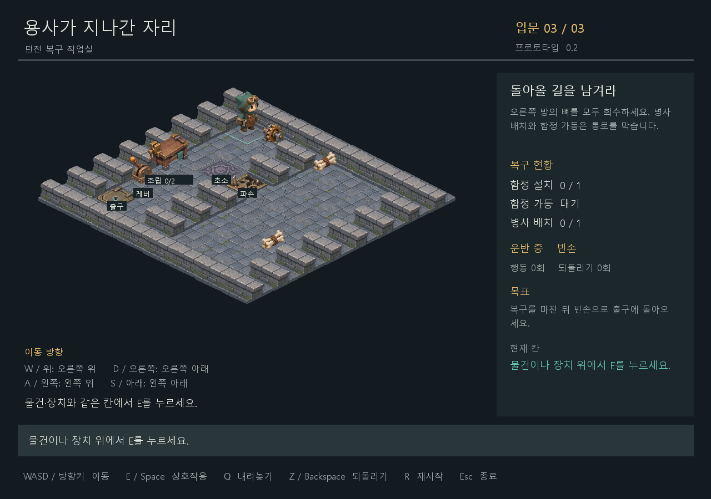

<div align="center">

# 용사가 지나간 자리

### 용사가 떠난 뒤, 던전의 복구가 시작된다.

**2.5D 던전 복구 퍼즐 · 2D게임프로그래밍 프로젝트**


[게임 기획서](./게임기획서.md) · [상세 개발 계획](./docs/상세개발계획.md) · [개발 기록](./docs/개발기록.md) · [1차 발표 PPT](./용사가%20지나간자리.pptx)

</div>

---

## 게임 소개

용사가 지나간 던전에는 부서진 함정과 흩어진 해골 병사의 뼈가 남았습니다.
부품을 운반하고, 함정을 설치하고, 병사를 조립해 던전을 다시 방어 가능한 상태로 만드세요.

**복구 순서가 이동 경로를 바꿉니다.**
남은 작업과 돌아갈 길을 생각하며 레버를 가동하는 시점을 결정해야 합니다.

## 핵심 플레이

| 시스템 | 플레이 | 현재 상태 |
| --- | --- | --- |
| 함정 복구 | 부품을 운반하고 지정 자리에 설치한 뒤 레버로 가동 | 구현 |
| 병사 복구 | 뼈 묶음 2개를 작업대에 납품해 병사를 조립하고 초소에 배치 | 프로토타입 규칙 구현 |
| 순서 퍼즐 | 함정·병사가 막을 경로를 고려해 복구와 복귀 순서 계획 | 3번 방 구현 |
| 뼈 투입구 | 뼈만 벽 너머로 전송 | 후속 설계 |
| 운반 벨트 | 부품·병사를 최대 한 칸씩 운반 | 후속 설계 |
| 되돌리기 | 유효 행동 전의 위치·운반·설치·조립·가동·클리어 상태 복원 | 구현 |

## 바로 실행

**입문방 3개를 플레이할 수 있는 프로토타입**입니다. 최종 8개 스테이지 중 입문 규칙을 검증하는 작은 방 3개이며, 난이도와 플레이 시간은 아직 조정하지 않았습니다. 제작한 2.5D 타일·장치·병사·수리공 에셋을 적용했습니다. 수리공은 이동 방향에 맞춰 걷고, 운반물을 손과 상태 패널에 표시합니다.



Windows와 Python 3.10 이상을 기준으로 작성했습니다. 실제 검증 환경과 결과는 [개발 기록](./docs/개발기록.md)에 남깁니다.

```powershell
python -m venv .venv
.\.venv\Scripts\python.exe -m pip install -r requirements.txt
.\.venv\Scripts\python.exe main.py
```

이미 pico2d가 설치된 Python에서는 `python main.py`로 실행할 수 있습니다. 파일 경로는 프로젝트 위치를 기준으로 계산하므로 다른 작업 폴더에서도 `python "프로젝트경로/main.py"`로 실행할 수 있습니다.

```powershell
python main.py --stage 3           # 세 번째 입문방에서 시작
python main.py --check             # 화면 없이 스테이지 데이터 검사
python -m unittest discover -v     # SDL 없이 게임 규칙 검사
python main.py --smoke-frames 3    # 실제 창을 3프레임 표시하고 종료
python -m tests.smoke_window      # SDL 키 이벤트로 세 방 UI 흐름 재생
```

| 키 | 동작 |
| --- | --- |
| WASD / 방향키 | 격자에서 한 칸 이동. 키를 한 번 누를 때 한 번 이동 |
| E / Space | **현재 서 있는 칸**의 물건 줍기·설치·납품·배치·레버 가동 |
| Q | 빈 일반 바닥에 들고 있는 물건 내려놓기 |
| Z / Backspace | 직전 유효 행동 되돌리기. 횟수 제한 없음 |
| R | 현재 방 재시작. 되돌리기 기록도 초기화 |
| Enter | 완료 후 다음 방. 마지막 방 완료 후 첫 방으로 복귀 |
| Esc / 창 닫기 | 종료 |

사선 화면에서 `W/위`는 오른쪽 위, `D/오른쪽`은 오른쪽 아래, `S/아래`는 왼쪽 아래, `A/왼쪽`은 왼쪽 위입니다. 화면 안에도 방향 안내가 있습니다.

### 현재 적용한 규칙

- 손에는 물건 하나만 듭니다. 뼈 묶음은 작업대에 하나씩 납품하며, 두 번째 납품으로 병사 하나를 조립해 듭니다.
- 설치한 함정은 통과할 수 있지만, 가동된 함정은 통과할 수 없습니다.
- 병사를 배치한 칸에서는 나갈 수 있으나 다시 들어올 수 없습니다. 설치·배치는 되돌리기로 취소합니다.
- 모든 함정을 설치한 뒤 빈손으로 레버를 가동합니다. 요구 병사를 모두 배치하고 **빈손으로 출구**에 도착하면 완료됩니다.
- 실패한 입력은 행동 수와 되돌리기 기록을 바꾸지 않습니다. 완료 직후에도 되돌리기와 재시작이 가능합니다.

위 세부 규칙은 개발을 위해 선택한 **프로토타입 결정**입니다. PPT 확정 내용과 후속 제안은 [상세 개발 계획](./docs/상세개발계획.md)에서 구분합니다.

### 글꼴과 실행 문제

Windows에서는 설치된 맑은 고딕을 사용합니다. 글꼴 파일은 저장소에 포함하지 않습니다. 다른 운영체제에서는 한글 TTF/TTC 경로를 지정할 수 있으나, 해당 운영체제의 게임 창은 아직 검증하지 않았습니다.

```powershell
$env:DUNGEON_FONT = 'C:\경로\한글글꼴.ttf'
python main.py
```

`ModuleNotFoundError`가 발생하면 게임을 실행하는 **같은 Python**으로 `python -m pip install -r requirements.txt`를 실행하세요. 창을 사용할 수 없는 환경에서는 `--check`와 `unittest`로 논리를 검사할 수 있습니다. 진행 상황은 파일로 저장하지 않습니다.

## 플레이 규모

| 항목 | 기획 목표 |
| --- | --- |
| 본편 | 튜토리얼 3개 포함, 총 8개 스테이지 |
| 공간 | 스테이지당 한 화면, 약 8×8~12×12칸 |
| 구성 | 입문 1–3단계 / 응용 4–7단계 / 종합 8단계 |
| 첫 플레이 | 고민·재시도 포함 60~70분 목표 |

> 플레이 시간은 기획 목표입니다. PPT의 구간별 시간 합계와 차이가 있어 플레이테스트 후 조정할 예정입니다.

## 개발 로드맵

- [x] **1주차 기초 범위** — 기본 화면, 운반, 되돌리기
- [ ] **2주차** — 함정·병사 복구와 입문방 3개 구현 완료, 최종 맵·난이도 검증 남음
- [ ] **3주차** — 발판·투입구·벨트, 4–7단계
- [ ] **4주차** — 8개 스테이지 완성, UI, 연출
- [ ] **5주차** — 전체 테스트, 발표 준비
- [ ] **6주차** — 최종 점검, 발표

## 프로젝트 자료

| 자료 | 내용 |
| --- | --- |
| [게임 기획서](./게임기획서.md) | 게임 규칙, 시스템, 스테이지 구성, 개발 계획, 검증 항목 |
| [상세 개발 계획](./docs/상세개발계획.md) | 규칙·상태 전이·스테이지·구조·검증·주차별 작업의 상세 명세 |
| [개발 기록](./docs/개발기록.md) | 기능별 구현 내용, 검증 결과, 현재 한계와 후속 작업 |
| [시각 에셋 1차 팩](./assets/art_v1/README.md) | 투명 PNG 44개, 아틀라스 3장, 조립 예시와 적용 좌표 |
| [1차 발표 PPT](./용사가%20지나간자리.pptx) | 수정된 발표 자료 원본, 8장 |

```text
2DGP-PROJECT/
├── README.md
├── 게임기획서.md
├── docs/                 # 상세 개발 계획과 개발 기록
├── main.py               # 실행 및 데이터 검사 진입점
├── requirements.txt      # pico2d 1.5.1
├── game/
│   ├── levels.py         # 스테이지 데이터와 검증
│   ├── model.py          # 화면과 독립적인 게임 규칙
│   ├── art.py            # 아틀라스 로딩과 기준점 변환
│   └── view.py           # pico2d 표시와 키 입력
├── assets/art_v1/        # 이미지·아틀라스·좌표·제작 원본
├── data/stages.json      # 8×8 입문방 3개
├── tests/                # 표준 unittest 회귀 검사
└── 용사가 지나간자리.pptx
```

## 개발 환경과 현재 상태

- **개발 환경:** Python · [pico2d 1.5.1](https://pypi.org/project/pico2d/1.5.1/)
- **현재 상태:** 1차 그래픽을 적용한 프로토타입 0.2
- **구현 범위:** 이동·운반·복구·되돌리기·3개 입문방·2.5D 에셋 화면·수리공 방향 및 걷기
- **후속 범위:** 발판·투입구·벨트·4–8단계·최종 아트·사운드·진행 저장·배포 패키지

기획서에서는 PPT에 명시된 내용과 보완 제안을 구분합니다. 세부 규칙은 개발과 플레이테스트를 통해 확정합니다.

---

<div align="center">

**김새누 · 2D게임프로그래밍**

</div>
