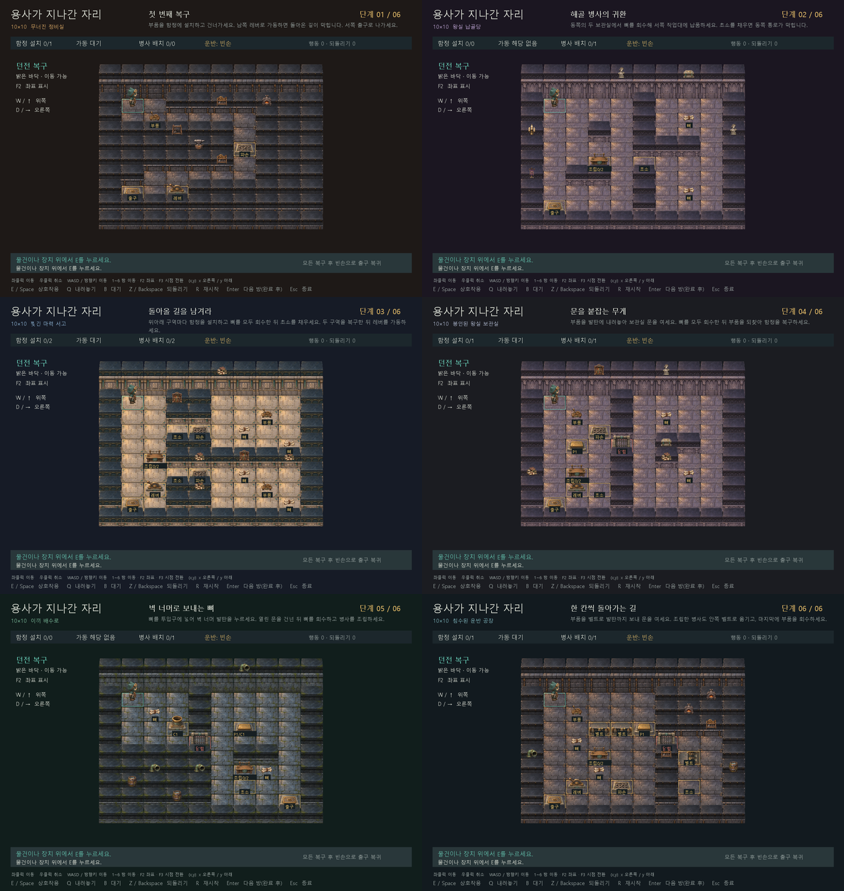

<div align="center">

# 용사가 지나간 자리

### 용사가 떠난 뒤, 던전의 복구가 시작된다.

**3/4 탑다운 던전 복구 퍼즐 · 2D게임프로그래밍 프로젝트**


[게임 기획서](./게임기획서.md) · [상세 개발 계획](./docs/상세개발계획.md) · [개발 기록](./docs/개발기록.md) · [1차 발표 PPT](./용사가%20지나간자리.pptx)

</div>

---

## 게임 소개

용사가 지나간 던전에는 부서진 함정과 흩어진 해골 병사의 뼈가 남았습니다.
부품을 운반하고, 함정을 설치하고, 병사를 조립해 던전을 다시 방어 가능한 상태로 만드세요.

**복구 순서가 이동 경로를 바꿉니다.**
남은 작업과 돌아갈 길을 생각하며 레버를 가동하는 시점을 결정해야 합니다.

## 핵심 플레이

| 시스템 | 플레이 | 현재 상태 |
| --- | --- | --- |
| 함정 복구 | 부품을 운반하고 지정 자리에 설치한 뒤 레버로 가동 | 구현 |
| 병사 복구 | 뼈 묶음 2개를 작업대에 납품해 병사를 조립하고 초소에 배치 | 프로토타입 규칙 구현 |
| 순서 퍼즐 | 함정·병사가 막을 경로를 고려해 복구와 복귀 순서 계획 | 3번 방 구현 |
| 발판·연결문 | 플레이어·물건의 무게로 연결문을 열고 안전하게 이탈 | 4번 방 구현 |
| 뼈 투입구 | 뼈를 벽 너머 배출구·발판으로 전송 | 5번 방 구현 |
| 운반 벨트 | 성공 행동·대기마다 부품·병사를 한 칸씩 운반 | 6번 방 구현 |
| 되돌리기 | 유효 행동 전의 위치·운반·설치·조립·가동·클리어 상태 복원 | 구현 |

## 바로 실행

**탑다운 전용 에셋을 적용한 프로토타입 0.8**입니다. 10×10 입문방 3개와 발판·투입구·벨트 응용방 3개를 플레이할 수 있습니다. 바닥이나 물건·장치를 왼쪽 클릭하면 해당 칸까지 이동하며, 키보드 조작도 사용할 수 있습니다. 1280×900 화면에서 방마다 지형·장식·배경색을 다르게 표시합니다. 최종 8개 스테이지의 난이도와 플레이 시간은 아직 조정하지 않았습니다.

기본 시점은 **정면에 가까운 3/4 탑다운**으로 확정했습니다. 가로축은 수평이고 세로 깊이는 가로의 약 65%입니다. [전용 에셋 64종](./assets/topdown_v1/README.md)을 새로 제작해 지형·장치·수리공 4방향·물건·소품에 적용했습니다. 사선 바닥을 변형하던 임시 처리는 제거했습니다. 기존 사선 뷰와 원본 에셋은 `F3` 비교용으로 보존하며, 전환 시 진행 상태와 운반물은 유지됩니다.



[1번 방](./docs/screenshots/topdown/stage-01.png) · [함정 가동 후](./docs/screenshots/topdown/stage-01-cleared.png) · [6번 방 문 열림](./docs/screenshots/topdown/stage-06-open.png). 보기 편하도록 F2 좌표만 숨긴 실제 SDL 화면입니다. [이전 사선 화면](./docs/screenshots/walls/overview.png)도 보존합니다.

1번 방은 이동 가능한 칸을 51칸에서 19칸으로 줄였습니다. 입구의 2×2 작업 공간, 한 칸 폭의 함정 통로, 남쪽 제어실과 출구로 구성합니다. 함정을 가동하면 입구로 돌아가는 유일한 길이 막히며, 제어실에서 서쪽 출구로 나갈 수 있습니다.

| 단계 | 분위기 | 주요 장식 |
| --- | --- | --- |
| 1 | 무너진 정비실 | 검은 석재, 철판, 모루·화덕·공구대 |
| 2 | 왕실 납골당 | 보라색 문장 바닥, 석관·깃발·촛대 |
| 3 | 찢긴 마력 서고 | 밝은 석재, 마법 문양, 책장·두루마리 |
| 4 | 봉인된 왕실 보관실 | 보라색 석재, 왕실 벽·석상·보관 가구 |
| 5 | 이끼 배수로 | 젖은 바닥, 이끼 벽, 수도관·물통·배수구 |
| 6 | 침수된 운반 공장 | 검은 석재와 철제 벨트, 화덕·수도관·물통 |

장식 배치와 색은 [data/scenery.json](./data/scenery.json)에서 조정합니다. 장식 소품 32개는 기존 벽칸에만 배치하며, 퍼즐 지도·이동·충돌 판정은 기존 규칙을 따릅니다.

탑다운은 전용 벽 윗면·앞면을 사용하고, 기존 장식 배치를 새 소품으로 연결합니다. 이전 [벽면 에셋 48종](./assets/wall_pack_v1/README.md), 벽 부착 장식과 잔해 표현은 사선 비교 뷰에 보존합니다. 지형의 색 변조는 캐릭터와 장치에 영향을 주지 않습니다.

Windows와 Python 3.10 이상을 기준으로 작성했습니다. 실제 검증 환경과 결과는 [개발 기록](./docs/개발기록.md)에 남깁니다.

```powershell
python -m venv .venv
.\.venv\Scripts\python.exe -m pip install -r requirements.txt
.\.venv\Scripts\python.exe main.py
```

이미 pico2d가 설치된 Python에서는 `python main.py`로 실행할 수 있습니다. 파일 경로는 프로젝트 위치를 기준으로 계산하므로 다른 작업 폴더에서도 `python "프로젝트경로/main.py"`로 실행할 수 있습니다.

```powershell
python main.py --stage 3           # 세 번째 입문방에서 시작
python main.py --check             # 화면 없이 스테이지 데이터 검사
python -m unittest discover -v     # SDL 없이 게임 규칙 검사
python main.py --smoke-frames 3    # 실제 창을 3프레임 표시하고 종료
python -m tests.smoke_window      # SDL 키 이벤트로 모든 방 UI 흐름 재생
python -m tests.smoke_click       # 실제 SDL 마우스 선택·경로·취소 검사
```

| 입력 | 동작 |
| --- | --- |
| 마우스 왼쪽 클릭 | 바닥·물건·장치의 해당 칸까지 현재 통행 가능한 최단 경로로 이동 |
| 마우스 오른쪽 클릭 | 남은 자동 이동 경로 취소 |
| WASD / 방향키 | 격자에서 한 칸 이동. 키를 한 번 누를 때 한 번 이동 |
| E / Space | **현재 서 있는 칸**의 물건 줍기·설치·납품·배치·레버 가동 |
| Q | 빈 바닥·발판·문·배출구에 내려놓기. 벨트에는 부품·병사만 가능 |
| B | 한 차례 대기. 벨트가 한 번 동작 |
| Z / Backspace | 직전 유효 행동 되돌리기. 횟수 제한 없음 |
| R | 현재 방 재시작. 되돌리기 기록도 초기화 |
| Enter | 완료 후 다음 방. 마지막 방 완료 후 첫 방으로 복귀 |
| Esc / 창 닫기 | 종료 |
| 1~6 (키보드 윗줄) | 개발용 방 이동. 해당 방을 초기 상태부터 시작 |
| F2 | 개발용 타일 좌표 표시 켜기·끄기. 기본값은 켜짐 |
| F3 | 3/4 탑다운·기존 사선 시점 전환. 진행 상태 유지, 자동 이동 취소 |

### 직접 배치할 때 사용하는 좌표

모든 타일에 `(x,y)`를 표시합니다. 10×10 방은 `(0,0)`부터 `(9,9)`까지이며 벽칸도 포함합니다. 3/4 탑다운은 왼쪽 위가 `(0,0)`이며 오른쪽으로 `x`, 아래로 `y`가 증가합니다. 기존 사선 뷰에서는 맨 위 꼭짓점이 `(0,0)`이며 오른쪽 아래로 `x`, 왼쪽 아래로 `y`가 증가합니다. [기존 사선 좌표 화면](./docs/screenshots/stage-03-coordinates.png)에서 확인할 수 있습니다.

- [data/stages.json](./data/stages.json)의 각 방 `map`에서 위에서부터 0번째가 `y=0` 행이고, 문자열의 첫 글자가 `x=0`입니다. 예를 들어 `(3,4)`는 다섯 번째 문자열의 네 번째 글자입니다.
- 통행을 막는 벽은 `#`, 빈 바닥은 `.`입니다. 외곽 테두리는 벽으로 유지합니다. 물건·장치가 있는 칸을 바꾸면 필요한 재료 수와 `plate_links`·`chute_links` 좌표도 맞춰야 합니다.
- 장식 소품 위치는 [data/scenery.json](./data/scenery.json)의 `cell: [x, y]`로 지정합니다. 장식은 벽칸에 배치하며, 벽을 바닥으로 바꾸면 그 칸의 장식도 옮기거나 제거합니다.
- 파일 수정 후 게임을 다시 실행하면 새 배치가 적용됩니다. `python main.py --check`로 지도 구조와 장치 연결을 검사할 수 있습니다.

숫자키로 방을 이동하면 운반물·복구 상태·행동 수·되돌리기 기록과 자동 이동이 초기화됩니다. 현재 방 번호를 눌러도 처음부터 시작합니다. `F2`의 좌표 표시 설정은 방을 이동해도 유지됩니다.

3/4 탑다운에서는 WASD·방향키가 화면의 상하좌우와 일치합니다. 사선 화면에서 `W/위`는 오른쪽 위, `D/오른쪽`은 오른쪽 아래, `S/아래`는 왼쪽 아래, `A/왼쪽`은 왼쪽 위입니다. 화면 안에도 방향 안내가 있습니다.

마우스를 올리면 이동 경로와 목표 칸을 미리 볼 수 있습니다. 클릭 이동은 약 0.18초 간격으로 한 칸씩 진행하며, 각 칸마다 벨트가 한 번 작동하고 되돌리기 기록이 하나 생깁니다. 물건 위에 도착해도 자동으로 줍지 않습니다. **도착한 칸에서 E / Space**로 상호작용하세요.

오른쪽 클릭이나 키보드 입력은 남은 자동 이동을 취소합니다. 경로 취소 자체가 이미 이동한 칸까지 되돌리지는 않으며, 키보드는 취소 후 해당 키의 동작을 실행합니다. 이동 중 문이 닫히거나 길이 막히면 멈추므로 다시 목적지를 클릭하세요. 현재 칸을 클릭하면 행동 수가 늘지 않고, UI나 맵 밖의 왼쪽 클릭은 무시합니다. 출구에서 클리어하면 남은 경로도 정지합니다.

### 현재 적용한 규칙

- 손에는 물건 하나만 듭니다. 뼈 묶음은 작업대에 하나씩 납품하며, 두 번째 납품으로 병사 하나를 조립해 듭니다.
- 설치한 함정은 통과할 수 있지만, 가동된 함정은 통과할 수 없습니다.
- 병사를 배치한 칸에서는 나갈 수 있으나 다시 들어올 수 없습니다. 설치·배치는 되돌리기로 취소합니다.
- 모든 함정을 설치한 뒤 빈손으로 레버를 가동합니다. 요구 병사를 모두 배치하고 **빈손으로 출구**에 도착하면 완료됩니다.
- 발판은 플레이어 또는 물건으로 눌립니다. 무게가 사라지면 문은 닫히지만, 문 위에 있던 플레이어·물건은 사라지지 않습니다. 닫힘 대기 중에는 새로 들어갈 수 없습니다.
- 투입구 위에서 뼈를 들고 E를 누르면 같은 ID의 배출구로 전송합니다. 물건·병사가 배출구를 막으면 전송하지 않습니다. 발판에 도착한 뼈는 문을 여는 추로 사용할 수 있습니다.
- 벨트는 성공한 이동·상호작용·내려놓기·대기마다 부품·조립한 병사를 최대 한 칸 옮깁니다. 뼈·플레이어·배치한 병사는 운반하지 않습니다. 점유된 목적지와 같은 칸으로 몰리는 물건은 정지합니다.
- 벨트 처리까지 한 번의 되돌리기에 포함합니다. 실패한 입력·되돌리기·재시작은 벨트를 진행시키지 않습니다.
- 실패한 입력은 행동 수와 되돌리기 기록을 바꾸지 않습니다. 완료 직후에도 되돌리기와 재시작이 가능합니다.

위 세부 규칙은 개발을 위해 선택한 **프로토타입 결정**입니다. PPT 확정 내용과 후속 제안은 [상세 개발 계획](./docs/상세개발계획.md)에서 구분합니다.

### 글꼴과 실행 문제

Windows에서는 설치된 맑은 고딕을 사용합니다. 글꼴 파일은 저장소에 포함하지 않습니다. 다른 운영체제에서는 한글 TTF/TTC 경로를 지정할 수 있으나, 해당 운영체제의 게임 창은 아직 검증하지 않았습니다.

```powershell
$env:DUNGEON_FONT = 'C:\경로\한글글꼴.ttf'
python main.py
```

`ModuleNotFoundError`가 발생하면 게임을 실행하는 **같은 Python**으로 `python -m pip install -r requirements.txt`를 실행하세요. 창을 사용할 수 없는 환경에서는 `--check`와 `unittest`로 논리를 검사할 수 있습니다. 진행 상황은 파일로 저장하지 않습니다.

## 플레이 규모

현재 프로토타입의 1~6번 방은 모두 10×10칸입니다. 후속 7~8번 방은 12×12칸으로 설계합니다. 4번 방에서는 부품을 발판의 추로 사용한 뒤 다시 회수해 함정을 복구합니다. 5번 방에서는 투입구로 뼈를 벽 너머 발판에 보냅니다. 6번 방에서는 벨트로 부품을 보내 발판을 누르고 병사를 운반합니다. 1번 방은 함정 복구, 2번 방은 병사 조립·배치, 3번 방은 두 함정과 두 병사의 복구 순서를 다룹니다. 아래 표는 원본 PPT의 본편 기획 목표입니다.

| 항목 | 기획 목표 |
| --- | --- |
| 본편 | 튜토리얼 3개 포함, 총 8개 스테이지 |
| 공간 | 스테이지당 한 화면, 약 8×8~12×12칸 |
| 구성 | 입문 1–3단계 / 응용 4–7단계 / 종합 8단계 |
| 첫 플레이 | 고민·재시도 포함 60~70분 목표 |

> 플레이 시간은 기획 목표입니다. PPT의 구간별 시간 합계와 차이가 있어 플레이테스트 후 조정할 예정입니다.

## 개발 로드맵

- [x] **1주차 기초 범위** — 기본 화면, 운반, 되돌리기
- [ ] **2주차** — 함정·병사 복구와 입문방 3개 구현 완료, 최종 맵·난이도 검증 남음
- [ ] **3주차** — 발판·투입구·벨트와 4–6단계 프로토타입 구현, 7단계·최종 난이도 남음
- [ ] **4주차** — 8개 스테이지 완성, UI, 연출
- [ ] **5주차** — 전체 테스트, 발표 준비
- [ ] **6주차** — 최종 점검, 발표

## 프로젝트 자료

| 자료 | 내용 |
| --- | --- |
| [게임 기획서](./게임기획서.md) | 게임 규칙, 시스템, 스테이지 구성, 개발 계획, 검증 항목 |
| [상세 개발 계획](./docs/상세개발계획.md) | 규칙·상태 전이·스테이지·구조·검증·주차별 작업의 상세 명세 |
| [개발 기록](./docs/개발기록.md) | 기능별 구현 내용, 검증 결과, 현재 한계와 후속 작업 |
| [시각 에셋 1차 팩](./assets/art_v1/README.md) | 투명 PNG 44개, 아틀라스 3장, 조립 예시와 적용 좌표 |
| [맵 테마 확장 팩](./assets/map_pack_v1/README.md) | 납골당·수로·제련소·서고 64종, 바닥·벽·소품과 배치 예시 |
| [1차 발표 PPT](./용사가%20지나간자리.pptx) | 수정된 발표 자료 원본, 8장 |

```text
2DGP-PROJECT/
├── README.md
├── 게임기획서.md
├── docs/                 # 상세 개발 계획과 개발 기록
├── main.py               # 실행 및 데이터 검사 진입점
├── requirements.txt      # pico2d 1.5.1
├── game/
│   ├── navigation.py    # 사선 좌표 선택과 한 칸씩 클릭 이동
│   ├── levels.py         # 스테이지 데이터와 검증
│   ├── model.py          # 화면과 독립적인 게임 규칙
│   ├── art.py            # 아틀라스 로딩과 기준점 변환
│   ├── scenery.py        # 좌표에 고정된 파손 흔적과 배경 색상
│   ├── themes.py         # 스테이지별 테마 선택과 장식 배치 확인
│   └── view.py           # pico2d 표시와 키보드·마우스 입력
├── assets/art_v1/        # 이미지·아틀라스·좌표·제작 원본
├── data/stages.json      # 10×10 입문 3개와 기믹 응용방 3개
├── tests/                # 표준 unittest 회귀 검사
└── 용사가 지나간자리.pptx
```

## 개발 환경과 현재 상태

- **개발 환경:** Python · [pico2d 1.5.1](https://pypi.org/project/pico2d/1.5.1/)
- **현재 상태:** 3/4 탑다운과 전용 에셋 64종을 적용한 프로토타입 0.8
- **구현 범위:** 클릭·키보드 이동·운반·복구·되돌리기·10×10 입문방 3개·발판·투입구·벨트 응용방·2.5D 에셋 화면·수리공 방향 및 걷기
- **후속 범위:** 7–8단계·최종 아트·사운드·진행 저장·배포 패키지

기획서에서는 PPT에 명시된 내용과 보완 제안을 구분합니다. 세부 규칙은 개발과 플레이테스트를 통해 확정합니다.

---

<div align="center">

**김새누 · 2D게임프로그래밍**

</div>
