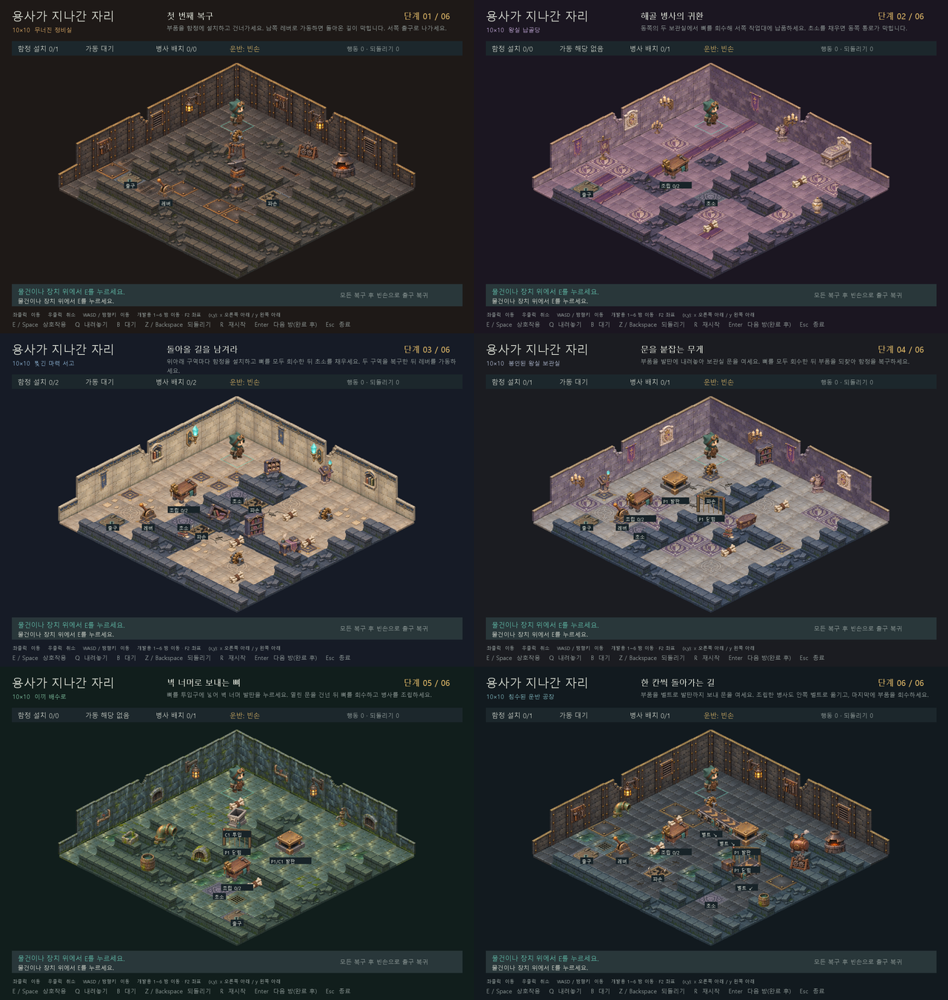

<div align="center">

# 용사가 지나간 자리

### 용사가 떠난 뒤, 던전의 복구가 시작된다.

**2.5D 던전 복구 퍼즐 · 2D게임프로그래밍 프로젝트**


[게임 기획서](./게임기획서.md) · [상세 개발 계획](./docs/상세개발계획.md) · [개발 기록](./docs/개발기록.md) · [1차 발표 PPT](./용사가%20지나간자리.pptx)

</div>

---

## 게임 소개

용사가 지나간 던전에는 부서진 함정과 흩어진 해골 병사의 뼈가 남았습니다.
부품을 운반하고, 함정을 설치하고, 병사를 조립해 던전을 다시 방어 가능한 상태로 만드세요.

**복구 순서가 이동 경로를 바꿉니다.**
남은 작업과 돌아갈 길을 생각하며 레버를 가동하는 시점을 결정해야 합니다.

## 배경음악

타이틀·시작 전 조작 안내에는 `Dungeon Title Theme`, 모든 플레이 방에는 `Interlocking Gears`를 반복 재생합니다. 방 이동·재시작에는 음악을 이어서 재생하고, 일시정지·장치 안내에서는 음량을 낮춥니다. 사용자가 제공한 Suno MP3와 음량·재생 규칙은 [bgm 안내](bgm/README.md)에 있습니다.

## 2026-11-13 기믹 변경

거울은 **90도씩 네 방향**으로 회전합니다. 빛은 들어오는 쪽과 관계없이 청록색 화살표가 가리키는 방향으로 나갑니다. 빛이 닿은 수신기는 보라색으로 빛납니다. 탑다운에서는 연결된 장치에 같은 색과 모양의 표식이 붙습니다. 마우스를 올리면 가리킨 장치 본체가 물들고, 연결된 장치의 윤곽선을 따라 같은 색의 빛이 퍼집니다. 연결 점선과 장치 상태도 나타납니다.

5번부터 장치 사용 순서가 중요합니다. 5번에서는 같은 이동 거울로 재료 창고와 출구를 번갈아 엽니다. 6번에서는 뼈로 발판을 누르고 광로를 바꿔 가며 복구 재료를 회수합니다. 7번에서는 부품으로 인부의 길을 먼저 열고, 8번에서는 두 인부에게 각각 발걸음을 기록한 뒤 마지막 광로를 출구로 돌립니다. 잔해는 0.28초 동안 캐릭터와 함께 움직이고, 발판 턱을 오른 뒤 눌립니다. [현재 배치](docs/방크기조정.md) · [해골 인부 개선 제안](docs/해골인부개선안.md).

## 2026-11-16 방 배치와 행동 제한 조정

방마다 장소의 역할에 맞춰 작업 구역을 나눴습니다. 지하 감옥은 무기고 앞의 감방 문 두 개를 함께 열어 둬야 합니다. 중계실 양 끝의 광원을 중앙 레일로 전환해 북동쪽 작업실과 남동쪽 보관실을 번갈아 엽니다. 레버는 북서쪽, 출구는 남서쪽에 있습니다. 보물창고는 두 개의 시간제 문을 건너고 그사이의 보관실에서 해골을 회수합니다. 왕좌실은 함정을 설치한 뒤, 해골 인부에게 방향을 기록해 두 문을 연달아 건넙니다. [현재 배치와 방별 행동 제한](docs/방크기조정.md)을 확인하세요. 아래 스크린샷은 제작 당시 기록입니다.

탑다운 화면은 통로와 작업 공간을 기준으로 방을 확대합니다. 작은 1번 방은 한 칸을 135px로 표시하며, 게임판을 왼쪽 튜토리얼 옆에 배치합니다. 클릭 좌표와 장치 안내는 게임판과 같은 배율을 사용합니다.

## 핵심 플레이

| 시스템 | 플레이 | 현재 상태 |
| --- | --- | --- |
| 함정 복구 | 부품을 운반하고 지정 자리에 설치한 뒤 레버로 가동 | 구현 |
| 병사 복구 | 뼈 묶음 2개로 해골을 조립하거나 준비된 해골을 데려와 초소에 배치 | 프로토타입 규칙 구현 |
| 순서 퍼즐 | 함정·병사가 막을 경로를 고려해 복구와 복귀 순서 계획 | 3번 방 구현 |
| 발판·연결문 | 플레이어·물건의 무게로 연결문을 열고 안전하게 이탈 | 4번 방 구현 |
| 뼈 투입구 | 뼈를 벽 너머 배출구·발판으로 전송 | 5번 방 구현 |
| 잔해 밀기 | 빈손으로 밀어 작업로 확보·발판 누르기 | 4번 방 구현 |
| 마력 거울과 차광 잔해 | 이동 거울을 밀고 회전해 광로를 맞춘 뒤, 빛을 막는 잔해를 옆으로 밀어 수신기에 빛 전달 | 5번 방 구현 |
| 해골 인부 | 기록석마다 한 번 방향을 기록. 인부가 일반 발판 위에 머무는 동안 연결문 개방 | 7·8번 방 구현 |
| 되돌리기 | 유효 행동 전의 위치·운반·설치·조립·가동·클리어 상태 복원 | 구현 |
| 행동 제한 | 1번 무제한, 2~8번은 방별 제한 | [방별 최단 풀이와 여유](docs/방크기조정.md) |

## 바로 실행

**기본 플레이 화면은 위에서 내려다보는 정사각 격자입니다.** 여덟 방의 지형과 수리공, 장치를 [새 탑다운 에셋](assets/topdown_v2/README.md)으로 표시합니다. `python main.py --stage 1`은 첫 방부터, `python main.py --isometric`은 기존 사선 화면으로 시작합니다. [탑다운 1번 방](docs/screenshots/topdown-v2/stage-01.png) · [8번 방](docs/screenshots/topdown-v2/stage-08.png) · [8번 방 광선 연결](docs/screenshots/topdown-v2/stage-08-powered.png).

모든 방에서 통로를 따라 벽의 윗돌과 앞면을 나눠 그립니다. 등불·수정·화로의 빛은 같은 박자로 서서히 넓어졌다 좁아지고, 벽 바깥의 암석과 배경으로 번집니다. 통로에서 멀어진 암석은 어둠 속으로 서서히 사라집니다. 켜진 마력 수신기에는 보랏빛, 열린 출구에는 청록빛이 번집니다. [조명 참고 화면 · Dungeon and Puzzles](https://nekolyst.com/games/dungeon-and-puzzles/)

| 방 | 이전 탑다운 화면 |
| --- | --- |
| 1. 무너진 정비실 | [시작](docs/screenshots/topdown-v2/stage-01.png) · [함정 가동](docs/screenshots/topdown-v2/stage-01-activated.png) |
| 2. 왕실 납골당 | [보랏빛 석재와 석관](docs/screenshots/topdown-v2/stage-02.png) |
| 3. 봉인된 마력 서고 | [밝은 석재와 수정 조명](docs/screenshots/topdown-v2/stage-03.png) |
| 4. 지하 감옥 | [강철색 석재와 발판](docs/screenshots/topdown-v2/stage-04.png) |
| 5. 이끼 배수로 | [이끼 낀 벽과 뼈 투입구](docs/screenshots/topdown-v2/stage-05.png) |
| 6. 마력 중계실 | [동서 광로와 중앙 차광 레일](docs/screenshots/topdown-v2/stage-06.png) |
| 7. 왕실 보물창고 | [청록 석재와 금속 현수막](docs/screenshots/topdown-v2/stage-07.png) |
| 8. 마왕의 왕좌실 | [붉은 석재와 화로](docs/screenshots/topdown-v2/stage-08.png) · [마력 연결](docs/screenshots/topdown-v2/stage-08-powered.png) |

**프로토타입 0.9**에는 폭 6~12칸, 높이 6~11칸인 방 여덟 개가 있습니다. 1600×960 화면에서 클릭·키보드로 이동하며 잔해 밀기는 방향키/WASD를 사용합니다. 모든 방의 최단 풀이를 검증했으며 사람의 초회 플레이 시간과 체감 난이도는 아직 측정하지 않았습니다.

7번 [왕실 보물창고](docs/screenshots/compact-rooms/stage-07-plan.svg), 8번 [마왕의 왕좌실](docs/screenshots/compact-rooms/stage-08-plan.svg)을 플레이할 수 있습니다. [현재 배치 안내](docs/방크기조정.md)를 확인하세요. 타이틀에서 숫자키 `7`, `8`로 바로 시작할 수 있습니다.

2026-11-11에 엄격한 행동 제한과 배치 규칙을 적용했습니다. [3번](./docs/screenshots/balance-v1/stage-03.png)·[4번](./docs/screenshots/balance-v1/stage-04.png)·[6번](./docs/screenshots/balance-v1/stage-06.png)의 현재 화면을 확인할 수 있습니다. 아래 벽면·테마 비교 화면은 배치 변경 전 기록입니다.



위 비교 화면 이후, 외곽의 막힌 칸이 일반 바닥처럼 보이지 않도록 높은 벽 앞에 낮은 석축을 추가했습니다. [통행 불가 표현을 보완한 1번 방](./docs/screenshots/stage-01-wall-collision.png)에서 현재 표시를 확인할 수 있습니다.

위 비교 화면은 이전 여섯 방의 기록입니다. [현재 1번 방](docs/screenshots/compact-rooms/stage-01.png)은 6×6이며 바닥은 19칸에서 11칸으로 줄였습니다. 준비 공간, 한 칸 폭의 함정 통로, 레버와 출구로 구성합니다. 함정을 가동하면 입구로 돌아가는 길이 막히지만 서쪽 출구로 나갈 수 있습니다.

| 단계 | 분위기 | 주요 장식 |
| --- | --- | --- |
| 1 | 무너진 정비실 | 모루·공구 걸이·호박색 등불 |
| 2 | 왕실 납골당 | 보랏빛 석재·석관·촛대 |
| 3 | 봉인된 마력 서고 | 책과 두루마리·청색 수정등 |
| 4 | 지하 감옥 | 감방 철문·쇠창살 창·간수 기록부 |
| 5 | 이끼 배수로 | 이끼 벽·수동 펌프·배관 |
| 6 | 마력 중계실 | 남청색 철판·환기구·냉각 배관 |
| 7 | 왕실 보물창고 | 청록 석재·황동 보물함·왕실 현수막 |
| 8 | 마왕의 왕좌실 | 붉은 석재·왕좌·철제 화로 |

장식 배치와 색은 [data/scenery.json](data/scenery.json)에서 조정합니다. 석관·모루·왕좌 같은 소품은 방 안쪽 벽감에 놓습니다. 벽등과 창살은 실내 바닥에 맞닿은 벽면에 붙이고, 조명도 그 벽면에서 실내 쪽으로 비춥니다.

[벽면 에셋 48종](./assets/wall_pack_v1/README.md)을 추가했습니다. 뒤쪽 두 변에는 높은 벽과 파손 벽을 연결하고, 양 끝은 낮은 벽으로 마감합니다. 등불·문장·깃발·배수구·배관·환기구·공구판·벽 책꽂이 등 부착 장식 36개가 방마다 다르게 배치됩니다. 기존 2:1 사선 시점을 유지하며 벽 높이까지 화면에 들어오도록 보드 위치를 조정했습니다.

벽 일부를 무너진 잔해로 바꾸고, 바닥 균열과 함정 주변의 그을음을 추가했습니다. 잔해는 벽과 같은 막힌 칸입니다. 장치와 캐릭터의 밝기는 유지해 복구 대상을 구별합니다.

여섯 방의 낮은 벽에 양방향 직선, 네 방향 ㄴ자 코너와 끝마감 기둥을 적용했습니다. 주변 벽과 통로 방향에 맞춰 자동으로 선택합니다. 납골당·서고·왕실 보관실은 석재 보수형을 중심으로, 배수로·공장은 파손·철띠 변형도 섞습니다. 방별 기존 색감을 유지한 [현재 여섯 방 비교 화면](./docs/screenshots/connected-walls/overview.png)에서 확인할 수 있습니다. 지도와 통행 판정은 그대로입니다.

Windows와 Python 3.10 이상을 기준으로 작성했습니다. 실제 검증 환경과 결과는 [개발 기록](./docs/개발기록.md)에 남깁니다.

```powershell
python -m venv .venv
.\.venv\Scripts\python.exe -m pip install -r requirements.txt
.\.venv\Scripts\python.exe main.py
```

이미 pico2d가 설치된 Python에서는 `python main.py`로 실행할 수 있습니다. 파일 경로는 프로젝트 위치를 기준으로 계산하므로 다른 작업 폴더에서도 `python "프로젝트경로/main.py"`로 실행할 수 있습니다.

기본 실행은 **시작 로고 모드**로 시작합니다. 흰 배경의 한국공학대학교 공식 시그니처를 2.2초 보여 준 뒤, 게임 세계관과 분리된 **우주·행성 테마의 2DGP 전용 일러스트**를 표시합니다. 청록색 **`2D`가 먼저 등장하고 0.58초 뒤 주황색 `GP`가 합류**합니다. 각 글자 묶음은 살짝 커졌다가 안착하며 2DGP 화면은 총 2.6초 재생합니다. 두 로고와 타이틀은 0.35초 페이드로 연결됩니다. 클릭·Space·Enter는 다음 로고, Esc는 타이틀로 바로 이동합니다. 타이틀로 돌아올 때는 로고를 반복하지 않으며 `--stage N`은 로고도 건너뜁니다. [학교 공식 원본·출처](./assets/splash_v1/README.md)와 [독립적인 2DGP 레이어·생성 프롬프트](./assets/splash_identity_v2/README.md)를 보존합니다.

[실제 시작 화면 6.33초 미리보기](./docs/screenshots/startup-identity-v2/startup-preview.gif)에서 학교 로고부터 글자 등장·타이틀 연결까지 확인할 수 있습니다.

로고 이후에는 [레이어 애니메이션 타이틀](./docs/screenshots/title-gestures-v2/title-preview.gif)이 표시됩니다. 던전 배경은 천천히 이동하고 중앙 로고는 등장 후 가볍게 떠 있습니다. 해골은 톱니를 머리 위로 들어 크게 흔들고 수리공은 3초마다 눈을 두 번 천천히 감으며 살짝 고개를 숙입니다. 첫 동작은 진입 후 1초 안에 보이며 [캐릭터 확대 미리보기](./docs/screenshots/title-gestures-v2/characters-preview.gif)에서 확인할 수 있습니다. 양쪽 횃불은 각각 8프레임과 불티로 움직입니다. 타이틀에는 게임 시작·게임 종료 버튼만 표시하며 버튼의 위치는 고정합니다. 화면에 표시하지 않는 **개발용 단축키(키보드 윗줄 1~8)**로 해당 방을 초기 상태부터 바로 테스트할 수 있습니다. [기존 레이어](./assets/title_motion_v1/README.md)와 [큰 손짓 에셋·생성 프롬프트](./assets/title_gestures_v2/README.md)를 보존합니다.

**게임 시작**을 선택하면 한 장의 **이미지 기반 4컷 만화**가 펼쳐집니다. **왼쪽 위, 오른쪽 위, 왼쪽 아래, 오른쪽 아래** 순서로 나타나며, 컷별 재생 시간은 **3.5초·3.5초·5초·3.5초**입니다. 마지막 컷은 시작 후 12초에 나타납니다. 수리공 컷은 걷기와 한숨을 끝까지 보여 주도록 조금 더 길게 재생합니다. 용사의 등장, 정복 후 퇴장, 야근을 한탄하는 수리공의 출근, 마왕 상사의 재촉으로 이어집니다. 해골 병사의 농담과 수리공의 대꾸로 이야기를 전달하며, 하단 설명문은 넣지 않았습니다. [완성된 네 컷](./docs/screenshots/worker-smooth-v2/panel-04.png)을 확인할 수 있습니다.

각 컷은 고정 배경 위에서 캐릭터가 독립적으로 움직입니다. 용사는 등장하거나 계단 쪽으로 떠나고, 해골은 떨거나 놀라며, 마왕은 몸을 들썩이며 재촉합니다. 세 번째 컷의 수리공은 **걷기 12장·감속과 들숨 12장·한숨과 마무리 12장, 총 36포즈**로 움직입니다. 0.25초부터 공구함을 끌고 걸으며 2.25~2.85초에 마지막 발을 모으며 서서히 멈춥니다. 총 이동 거리는 약 107px이며 걸음 포즈는 이동 거리에 맞춰 진행합니다. 2.85~3.45초 들숨, 3.45~4.65초 한숨 뒤 지친 자세를 유지합니다. [24fps로 캡처한 수리공 동작 미리보기](./docs/screenshots/worker-smooth-v2/worker-preview.gif)를 확인할 수 있습니다. 게임은 [수리공 투명 PNG 36포즈](./assets/worker_motion_v2/README.md)와 [기존 배경·다른 인물](./assets/comic_motion_v1/README.md)을 사용합니다.

효과음 글자와 두 말풍선은 시간차로 표시하며, 한숨 구간의 효과음은 ‘하아...’로 바뀝니다. 일시정지하면 캐릭터·숨 효과·컷 재생이 함께 멈추고, 다시 보기에서 처음부터 재생합니다. 이전 컷은 동작이 끝난 자세로 유지하고, 뒤로 돌아가도 완성된 컷을 읽을 수 있습니다. 아직 나오지 않은 컷은 빈칸으로 유지하며 글꼴은 기존 주아체를 사용합니다.

용사의 등장·정복과 마왕의 호통에는 **짧은 컷 내부 흔들림과 충격선**이 표시됩니다. 검·보물 주변에는 반짝임이, 수리공의 걸음에는 작은 먼지가, 한숨에는 아래로 처지는 피로선이 붙습니다. 말풍선과 다른 컷은 고정하며 효과는 일시정지·재생·다시 보기와 동기화합니다. [효과를 적용한 15.5초 미리보기](./docs/screenshots/comic-effects/page-preview.gif)에서 확인할 수 있습니다.

전체 효과음을 **과장된 만화·슬랩스틱 스타일**로 교체했습니다. 용사는 짧게 상승하는 색소폰 팡파르, 두 번째 컷은 0.28초에 나무·금속·유리가 와장창 부딪히고 마지막 조각이 튕기는 소리, 마왕은 짧고 신경질적인 크리처 호통으로 표현합니다. 수리공은 콘크리트 발 디딤·옷 스침에 작은 ‘뿅’을 섞고, 실제 사람의 한숨 뒤로 작게 처지는 악기음을 더했습니다. [녹음·게임 음원을 편집한 효과음 6종과 출처·라이선스](./assets/audio_story_v2/README.md), [8.4초 미리듣기](./docs/audio/cartoon-v2/sounds-preview.wav), [실제 장면 타이밍 15.5초](./docs/audio/cartoon-v2/story-timeline.wav)를 제공합니다. 기존 파형 합성 음원은 보존하며 게임은 새 v2 음원을 사용합니다. 일시정지는 재생 중인 소리도 멈추고, 재개하면 이어집니다. 컷 이동·건너뛰기·타이틀 복귀·종료 시 이전 소리를 정리하고, 프레임이 오래 멈췄을 때 지난 소리를 한꺼번에 재생하지 않습니다. 오디오 장치가 없으면 무음으로 진행합니다. 시스템 음량은 변경하지 않습니다.

현재 컷 클릭·Space·오른쪽 방향키 또는 **다음 컷** 버튼으로 바로 진행할 수 있습니다. **일시정지/자동재생**으로 읽는 속도를 조절하며, 이전 컷으로 돌아가면 자동 재생을 잠시 멈춥니다. 마지막 컷은 화면에 유지되고 **다시 보기**로 처음부터 재생할 수 있습니다. **작업 안내** 또는 **건너뛰기**를 누르면 [복구 목표 설명](./docs/screenshots/overtime-story/repair-guide.png), [조작·복귀 안내](./docs/screenshots/overtime-story/controls.png)가 차례로 나옵니다. **1번 방 시작**은 첫 방의 튜토리얼로 연결됩니다. Esc는 카툰·안내에서 타이틀로 돌아가며, 다시 게임을 시작하면 첫 컷부터 재생합니다. `--stage N`은 타이틀·카툰·시작 조작 안내를 건너뛰고 해당 방에 입장합니다.

**1번 방은 5단계 튜토리얼**입니다. 부품까지 이동, 줍기, 함정 설치, 건너편 레버 가동, 빈손으로 출구 복귀를 순서대로 안내합니다. 단계가 시작되면 왼쪽 카드와 목표 표시가 4초 동안 나타납니다. 표시된 목표 이름을 클릭해도 이동할 수 있습니다. 다른 단계로 되돌아가거나 방을 재시작하면 해당 단계의 안내가 다시 나타납니다. 행동 제한은 없으며 완료 후 E / Space로 2번 방에 입장합니다. [첫 안내](./docs/screenshots/onboarding/room-01.png), [함정 설치 안내](./docs/screenshots/onboarding/install.png), [튜토리얼 완료](./docs/screenshots/onboarding/complete.png)를 확인할 수 있습니다.

**방 시작·복구 완료 연출**이 있습니다. 2~8번 방에 들어가면 방의 주제를 담은 한 줄이 상단에 나타나고 5초 안에 서서히 사라집니다. 문구가 떠 있는 동안 바로 움직일 수 있고 일시정지에서는 표시 시간도 멈춥니다. 빈손으로 출구까지 복귀하면 완료 도장과 사용·남은 행동 수, 함정 가동·병사 배치 실적이 표시됩니다. E/Space 또는 결과 화면의 버튼으로 다음 방에 갈 수 있고 Z 되돌리기·R 재시작·Esc 메뉴도 사용할 수 있습니다. 마지막 방은 전체 복구 완료를 알리고 처음부터 다시 시작합니다. [마지막 방 작업 보고](./docs/screenshots/stage-feedback/clear-08.png)를 확인할 수 있습니다.

**장치 안내**는 새 장치가 처음 등장하는 방의 작업 전에 열립니다. Enter / Space로 다음 장치나 작업 시작을 선택하고, Esc로 건너뜁니다. 플레이 중에는 Esc 메뉴의 조작법에서 다시 열 수 있습니다. 숫자키 개발용 방 이동은 바로 플레이로 연결됩니다. [안내 화면](docs/screenshots/gimmicks-v1/device-guide/stage_05-mirror.png)을 확인하세요.

**Esc 일시정지 메뉴**에서 계속하기·다시 시작·조작법·장치 도감·타이틀 복귀를 선택할 수 있습니다. 방향키 또는 W/S·Tab으로 선택하고 Enter/Space나 마우스 클릭으로 실행합니다. 메뉴와 조작법을 읽는 동안 자동 이동, 걷기, 문·발판 애니메이션이 함께 멈추며, 계속하기는 멈춘 시점과 남은 경로부터 재개합니다. 다시 시작과 타이틀 복귀는 현재 방의 진행을 초기화합니다. [일시정지 화면](./docs/screenshots/play-menu/pause.png), [조작법 화면](./docs/screenshots/play-menu/controls.png)을 확인할 수 있습니다.

**카드형 장치 도감**은 Esc 메뉴에서 엽니다. 함정·레버·병사·발판·투입구·잔해·거울·해골 인부, 총 8종을 세 페이지로 설명합니다. 현재 방의 장치는 별도로 표시하며, 좌우 키와 마우스로 페이지를 넘깁니다. [기존 도감 화면](docs/screenshots/gimmicks-v1/device-catalog/page-03.png)을 확인하세요.

플레이 화면 상단에는 방 이름과 해당 방의 **함정 설치·가동, 병사 배치 수**를 표시합니다. 운반 중에는 물건 이름과 아이콘이 나타납니다. **남은 행동은 주인공 머리 위의 숫자 배지**로 표시하며, 제한이 없는 1번 방에는 ‘무제한’을 표시합니다. 하단에는 현재 작업, 자동 이동, 행동 소진 같은 상황별 안내가 나타납니다. 기본 조작법은 Esc 메뉴에서 확인할 수 있습니다.

남은 행동이 **제한의 20% 이하(최소 5회)**이면 숫자 배지가 노랗게 바뀌고, 주인공이 몸을 낮추며 땀을 흘리고 ‘후우…’ 하고 숨을 쉽니다. **5회 이하**에서는 붉은 숫자와 더 가쁜 숨·‘헉…’, **0회**에서는 더 주저앉은 자세와 ‘털썩…’을 표시합니다. 이동 속도와 행동 비용은 그대로이며, 되돌리기는 복구된 행동 수에 맞춰 피로를 되돌립니다. 재시작·방 전환·클리어 때 정상 자세로 복귀합니다. 숫자 배지는 클릭해도 이동하지 않습니다. [10회 남음](./docs/screenshots/action-feedback/tired.png), [5회 남음](./docs/screenshots/action-feedback/critical.png), [소진](./docs/screenshots/action-feedback/failed.png)을 확인할 수 있습니다.

```powershell
python main.py --stage 3           # 세 번째 입문방에서 시작
python main.py --check             # 화면 없이 스테이지 데이터 검사
python -m unittest discover -v     # SDL 없이 게임 규칙 검사
python tools/solve_levels.py --check --check-mechanics # 최소 행동·제한·핵심 기믹 검사
python main.py --smoke-frames 3    # 실제 창을 3프레임 표시하고 종료
python -m tests.smoke_window      # SDL 키 이벤트로 모든 방 UI 흐름 재생
python -m tests.smoke_click       # 실제 SDL 마우스 선택·경로·취소 검사
python -m tests.smoke_placement   # 물건·새 장치 접점과 알파 클릭 검사
python -m tests.smoke_gimmicks    # 새 기믹 4종·완주·실제 화면 13장 검사
python -m tests.smoke_interactions # 상호작용 표식·E 안내·표식 클릭·되돌리기 검사
python -m tests.smoke_gates       # 발판 문 개폐·통과·닫힘 대기·투명 영역 클릭 검사
python -m tests.smoke_gate_animation # 개폐 시간·중간 프레임·역방향 전환·애니메이션 클릭 검사
python -m tests.smoke_plate_animation # 발판 승강·탑승물 높이·반전·되돌리기·클릭 검사
python -m tests.smoke_action_limits # 실제 횟수 소진·입력 정지·되돌리기·재시작 검사
python -m tests.smoke_comic       # 창 없는 네 컷·캐릭터 동작·고정 배경·일시정지 검사
python -m tests.smoke_stage_feedback # 시작·완료·결과 수치·다음 방·되돌리기 검사
python -m tests.smoke_play_menu   # 플레이 메뉴·시간 정지·재개·입력 격리 검사
python -m tests.smoke_music       # 실제 MP3 디코딩·반복·화면별 BGM·메뉴 음량·종료 정리 검사
python -m tests.smoke_device_catalog # 장치 그림·카드 여백·페이지 이동·입력 격리 검사
python -m tests.smoke_device_guide # 입장 안내와 수동 장치 안내 검사
python -m tests.smoke_onboarding  # 타이틀·카툰 4컷·안내 2장·튜토리얼·첫 방 클리어 검사
```

금색 마름모는 주울 수 있는 물건과 작업할 장치를 표시합니다. 표식이나 물체에 마우스를 올리면 하단에 이름이 나옵니다. 작업대와 고정 거울을 클릭하면 가까운 옆 칸으로 이동합니다. 행동 조건을 충족하면 대상의 표식이 청록색 **E**로 바뀝니다. [표식 적용 화면](./docs/screenshots/interaction-markers-stage-06.png), [줍기 가능한 상태](./docs/screenshots/interaction-markers-ready.png)를 확인할 수 있습니다.

초소는 **파손된 갑옷 거치대와 보라색 발판이 연결된 하나의 몬스터 배치대**로 표시합니다. 거치대를 황동 고정부에 세우고 천·방패가 발판에 닿도록 함께 그려 비율과 색감을 맞췄습니다. 크게 깨진 투구·어깨 갑옷·방패와 앞쪽의 작은 발자국으로 배치할 자리를 알립니다. 조립한 병사를 놓으면 같은 디자인의 바닥 위에 병사가 서고, 이름표도 ‘몬스터 배치’에서 ‘배치 완료’로 바뀝니다. 되돌리기·재시작하면 파손된 배치대가 돌아옵니다. [배치 전](./docs/screenshots/monster-post/empty.png), [배치 후](./docs/screenshots/monster-post/occupied.png), [원본과 제작 프롬프트](./assets/art_v1/README.md)를 확인할 수 있습니다.

**뼈 투입구와 배출구**에는 같은 연결 ID를 표시합니다. 어느 한쪽에 마우스를 올리면 두 위치를 강조합니다. 배출구는 발판 위에 청록색 주둥이와 뼈 문장이 달린 별도 그림으로 표시합니다. 5번 방처럼 앞쪽 문이 투입구를 가리면 그 문만 반투명하게 표시하며, 비쳐 보이는 투입구를 클릭해 해당 칸으로 이동할 수 있습니다. 뼈를 든 채 그 칸에서 E를 누르면 기존처럼 연결된 배출구로 전송합니다. 문이 닫힌 상태의 통행 제한은 그대로입니다. [5번 방의 투입구](./docs/screenshots/vent-v2/inlet-visible.png)를 확인할 수 있습니다.

탑다운 연결문은 열릴 때 두 철제 문짝이 석재 기둥 안으로 들어갑니다. 사선 화면의 철제 격자는 위로 올라갑니다. 움직이는 도중 전원이 바뀌면 현재 위치에서 반대로 움직입니다. 열린 문은 청록색, 닫힌 문은 붉은색, 사람이 나가기를 기다리는 문은 금색 안내로 구분합니다. [사선 화면 개폐 미리보기](./docs/screenshots/gate-animation/preview.gif).

발판도 0.24초 동안 눌리고 복귀합니다. 석재 받침은 고정되며 상판과 위에 놓인 물건·캐릭터가 함께 움직입니다. 중간에 무게가 바뀌거나 되돌려도 현재 높이에서 이어집니다. [발판 애니메이션](./docs/screenshots/plate-animation/preview.gif)을 확인할 수 있습니다.

[방마다 다른 행동 제한](docs/방크기조정.md)을 적용합니다. 성공한 이동·상호작용·잔해 밀기는 각각 1회이며 실패 입력은 차감하지 않습니다. Z / Backspace로 상태와 횟수를 되돌리고 R로 재시작합니다. [기준 풀이](tests/solutions.py), [탐색 보고서](docs/balance-report.json), [배치 규칙](docs/퍼즐배치규칙.md)을 참고하세요.

| 입력 | 동작 |
| --- | --- |
| 마우스 왼쪽 클릭 | 지정한 칸까지 최단 경로로 이동. 작업대와 고정 거울은 인접한 칸으로 이동 |
| 방향키 / WASD | 빈손으로 잔해나 이동 거울이 있는 쪽을 누르면 한 칸 밀기 |
| 마우스 오른쪽 클릭 | 남은 자동 이동 경로 취소 |
| WASD / 방향키 | 격자에서 한 칸 이동. 키를 한 번 누를 때 한 번 이동 |
| E / Space | 줍기·설치·병사 배치·레버 가동·뼈 전송·내려놓기. 작업대 납품과 고정 거울 회전은 옆 칸에서, 이동 거울 회전은 위에서 실행. 완료 후 다음 방으로 진행 |
| Z / Backspace | 직전 유효 행동 되돌리기. 횟수 제한 없음 |
| R | 현재 방 재시작. 되돌리기 기록도 초기화 |
| Esc | 플레이 중 일시정지 메뉴. 카툰·설명 화면에서는 타이틀로 복귀 |
| 창 닫기 | 게임 종료 |
| 1~8 (키보드 윗줄) | 타이틀·게임 중 해당 방을 초기 상태부터 시작. 타이틀에서는 스토리·설명을 건너뛰고 바로 입장 |
| F2 | 개발용 타일 좌표 표시 켜기·끄기. 기본값은 꺼짐 |

### 직접 배치할 때 사용하는 좌표

F2를 켜면 벽을 포함한 모든 타일에 `(x,y)`를 표시합니다. 탑다운 화면의 왼쪽 위가 `(0,0)`이며 오른쪽으로 `x`, 아래로 `y`가 증가합니다. 10×10 방의 오른쪽 아래는 `(9,9)`입니다.

- [data/stages.json](./data/stages.json)의 각 방 `map`에서 위에서부터 0번째가 `y=0` 행이고, 문자열의 첫 글자가 `x=0`입니다. 예를 들어 `(3,4)`는 다섯 번째 문자열의 네 번째 글자입니다.
- 통행을 막는 벽은 `#`, 빈 바닥은 `.`입니다. 외곽 테두리는 벽으로 유지합니다. 물건·장치가 있는 칸을 바꾸면 필요한 재료 수와 `plate_links`·`chute_links` 좌표도 맞춰야 합니다.
- 장식은 [data/scenery.json](./data/scenery.json)에서 벽칸 `cell`과 실내 바닥을 향하는 방향 `facing`으로 지정합니다. 일반 소품은 외곽선 안쪽 벽칸을 사용합니다.
- 파일 수정 후 게임을 다시 실행하면 새 배치가 적용됩니다. `python main.py --check`로 지도 구조와 장치 연결을 검사할 수 있습니다.

숫자키로 방을 이동하면 운반물·복구 상태·행동 수·되돌리기 기록과 자동 이동이 초기화됩니다. 현재 방 번호를 눌러도 처음부터 시작합니다. `F2`의 좌표 표시 설정은 방을 이동해도 유지됩니다.

탑다운 화면에서 `W/위`, `D/오른쪽`, `S/아래`, `A/왼쪽`은 화면의 위·오른쪽·아래·왼쪽에 대응합니다. 기존 사선 화면에서는 오른쪽 위·오른쪽 아래·왼쪽 아래·왼쪽 위에 대응합니다.

마우스를 올리면 이동 경로와 목표 칸을 미리 볼 수 있습니다. 클릭 이동은 약 0.18초 간격으로 한 칸씩 진행하며, 한 칸 이동마다 장치 상태와 행동을 기록합니다. Z로 직전 행동을 되돌릴 수 있습니다. 물건 위에 도착해도 자동으로 줍지 않습니다. **도착한 칸에서 E / Space**로 상호작용하세요.

목표 칸에 마우스를 올리면 커서 옆에 **예상 차감 -N회**와 남은 행동을 표시합니다. 현재 통행 가능한 클릭 경로의 한 칸당 1회이며, 도착 후 상호작용 비용은 포함하지 않습니다. 현재 칸은 0회, 도달할 수 없는 칸은 이동 불가로 표시합니다. 남은 행동보다 경로가 길면 부족한 횟수와 경로를 빨간색으로 표시합니다. 미리보기는 행동을 소모하지 않으며, 이동 도중 문 상태가 바뀌어 경로가 막히면 실제 차감은 표시한 예상치보다 적을 수 있습니다.

물건을 들고 내려놓을 수 있는 빈 칸에 서면 하단에 **E / Space: 내려놓기** 안내가 나옵니다. 함정·작업대·초소·레버·투입구에서는 해당 장치 작업을 우선하며, 작업 조건이 맞지 않으면 내려놓기로 바뀌지 않습니다. Q 키는 사용하지 않습니다.

오른쪽 클릭이나 키보드 입력은 남은 자동 이동을 취소합니다. 경로 취소 자체가 이미 이동한 칸까지 되돌리지는 않으며, 키보드는 취소 후 해당 키의 동작을 실행합니다. 이동 중 문이 닫히거나 길이 막히면 멈추므로 다시 목적지를 클릭하세요. 현재 칸을 클릭하면 행동 수가 늘지 않고, UI나 맵 밖의 왼쪽 클릭은 무시합니다. 출구에서 클리어하면 남은 경로도 정지합니다.

### 현재 적용한 규칙

- 손에는 물건 하나만 듭니다. 뼈 묶음은 작업대에 하나씩 납품하며, 두 번째 납품으로 병사 하나를 조립해 듭니다.
- 설치한 함정은 통과할 수 있지만, 가동된 함정은 통과할 수 없습니다.
- 병사를 배치한 칸에서는 나갈 수 있으나 다시 들어올 수 없습니다. 설치·배치는 되돌리기로 취소합니다.
- 모든 함정을 설치한 뒤 빈손으로 레버를 가동합니다. 요구 병사를 모두 배치하고 **빈손으로 출구**에 도착하면 완료됩니다.
- 발판은 플레이어 또는 물건으로 눌립니다. 무게가 사라지면 문은 닫히지만, 문 위에 있던 플레이어·물건은 사라지지 않습니다. 닫힘 대기 중에는 새로 들어갈 수 없습니다.
- 투입구 위에서 뼈를 들고 E를 누르면 같은 ID의 배출구로 전송합니다. 물건·병사가 배출구를 막으면 전송하지 않습니다. 발판에 도착한 뼈는 문을 여는 추로 사용할 수 있습니다.
- 거울 옆 칸에서 빈손으로 E / Space를 누르면 90도 회전합니다. 수신기에 닿은 빛이 연결문을 엽니다.
- 빈손으로 잔해 쪽 방향키를 누르면 한 칸 밀며 이동합니다. 빈 바닥·발판으로만 밀고 당기기는 불가능합니다.
- 기록석을 밟으면 기록석마다 한 번 발걸음을 기록합니다. 완료 후 수리공이 행동할 때마다 인부가 자기 위치에서 한 걸음씩 따라갑니다. 인부도 일반 발판을 눌러 문을 열며, 마지막 발판 위에 서 있으면 문이 열린 채로 유지됩니다.
- 실패한 입력은 행동 수와 되돌리기 기록을 바꾸지 않습니다. 완료 직후에도 되돌리기와 재시작이 가능합니다.

위 세부 규칙은 개발을 위해 선택한 **프로토타입 결정**입니다. PPT 확정 내용과 후속 제안은 [상세 개발 계획](./docs/상세개발계획.md)에서 구분합니다.

### 글꼴과 실행 문제

버튼·말풍선·제목에는 둥글고 굵은 **배민 주아체(Jua)**를, 작은 안내·HUD에는 **고운돋움(Gowun Dodum)**을 사용합니다. 주아체에 없는 방향 화살표도 작은 안내에서 선명하게 표시합니다. [두 글꼴과 SIL OFL 1.1 라이선스](./assets/fonts/README.md)를 저장소에 포함해 별도 설치 없이 표시합니다. `DUNGEON_FONT`로 다른 한글 TTF/TTC를 우선 지정할 수 있습니다. 기본 글꼴 파일이 없으면 시스템 한글 글꼴을 사용합니다. 다른 운영체제의 게임 창은 아직 검증하지 않았습니다.

```powershell
$env:DUNGEON_FONT = 'C:\경로\한글글꼴.ttf'
python main.py
```

`ModuleNotFoundError`가 발생하면 게임을 실행하는 **같은 Python**으로 `python -m pip install -r requirements.txt`를 실행하세요. 창을 사용할 수 없는 환경에서는 `--check`와 `unittest`로 논리를 검사할 수 있습니다. 진행 상황은 파일로 저장하지 않습니다.

## 플레이 규모

1~3번의 함정·병사·복구 순서와 4번 감방 연쇄 개방, 5번 수로 전송, 6번 광선 전환, 7번 해골 인부 기록, 8번 제어실 봉쇄를 적용했습니다. [좌표와 풀이](docs/방크기조정.md)를 참고하세요. 아래 표는 원본 PPT의 본편 기획 목표입니다.

| 항목 | 기획 목표 |
| --- | --- |
| 본편 | 튜토리얼 3개 포함, 총 8개 스테이지 |
| 공간 | 스테이지당 한 화면, 약 8×8~12×12칸 |
| 구성 | 입문 1–3단계 / 응용 4–7단계 / 종합 8단계 |
| 첫 플레이 | 고민·재시도 포함 60~70분 목표 |

> 플레이 시간은 기획 목표입니다. PPT의 구간별 시간 합계와 차이가 있어 플레이테스트 후 조정할 예정입니다.

## 개발 로드맵

- [x] **1주차 기초 범위** — 기본 화면, 운반, 되돌리기
- [ ] **2주차** — 함정·병사 복구와 입문방 3개 구현 완료, 최종 맵·난이도 검증 남음
- [x] **3주차 기믹 초안** — 발판·투입구와 새 기믹 4종, 8개 방 완주 검증. 새 방 최종 난이도 조정은 남음.
- [ ] **4주차** — 8개 스테이지 완성, UI, 연출
- [ ] **5주차** — 전체 테스트, 발표 준비
- [ ] **6주차** — 최종 점검, 발표

## 프로젝트 자료

| 자료 | 내용 |
| --- | --- |
| [게임 기획서](./게임기획서.md) | 게임 규칙, 시스템, 스테이지 구성, 개발 계획, 검증 항목 |
| [상세 개발 계획](./docs/상세개발계획.md) | 규칙·상태 전이·스테이지·구조·검증·주차별 작업의 상세 명세 |
| [개발 기록](./docs/개발기록.md) | 기능별 구현 내용, 검증 결과, 현재 한계와 후속 작업 |
| [시각 에셋 1차 팩](./assets/art_v1/README.md) | 투명 PNG 44개, 아틀라스 3장, 조립 예시와 적용 좌표 |
| [맵 테마 확장 팩](./assets/map_pack_v1/README.md) | 납골당·수로·제련소·서고 64종, 바닥·벽·소품과 배치 예시 |
| [1차 발표 PPT](./용사가%20지나간자리.pptx) | 수정된 발표 자료 원본, 8장 |

```text
2DGP-PROJECT/
├── README.md
├── 게임기획서.md
├── docs/                 # 상세 개발 계획과 개발 기록
├── main.py               # 실행 및 데이터 검사 진입점
├── requirements.txt      # pico2d 1.5.1
├── game/
│   ├── navigation.py    # 사선 좌표 선택과 한 칸씩 클릭 이동
│   ├── levels.py         # 스테이지 데이터와 검증
│   ├── model.py          # 화면과 독립적인 게임 규칙
│   ├── front_end.py      # 그림 타이틀·스토리 카툰·복구 및 조작 안내
│   ├── story.py          # 용사·수리공·마왕·해골 병사의 4컷 대사와 재생 상태
│   ├── comic.py          # 네 컷 페이지·말풍선·효과음 렌더링
│   ├── comic_motion.py   # 고정 배경 위 독립 캐릭터 이미지 합성
│   ├── character_motion.py # 수리공 걷기·한숨 타이밍과 포즈
│   ├── tutorial.py       # 1번 방 상태에 맞춘 5단계 안내
│   ├── art.py            # 아틀라스 로딩과 기준점 변환
│   ├── scenery.py        # 좌표에 고정된 파손 흔적과 배경 색상
│   ├── themes.py         # 스테이지별 테마 선택과 장식 배치 확인
│   └── view.py           # pico2d 표시와 키보드·마우스 입력
├── assets/art_v1/        # 이미지·아틀라스·좌표·제작 원본
├── data/stages.json      # 기믹별 방 8개와 행동 제한
├── tests/                # 표준 unittest 회귀 검사
└── 용사가 지나간자리.pptx
```

## 개발 환경과 현재 상태

- **개발 환경:** Python · [pico2d 1.5.1](https://pypi.org/project/pico2d/1.5.1/)
- **현재 상태:** 새 기믹 4종, 방 8개, 방별 행동 제한을 적용한 프로토타입 0.9
- **구현 범위:** 클릭·키보드 이동·운반·복구·되돌리기·소형 입문방 3개·발판·투입구·거울·잔해·인부 응용방·2.5D 에셋 화면·수리공 방향 및 걷기
- **후속 범위:** 새 방 플레이 평가·최단 탐색·행동 제한·장치 애니메이션과 효과음·진행 저장·배포 패키지

기획서에서는 PPT에 명시된 내용과 보완 제안을 구분합니다. 세부 규칙은 개발과 플레이테스트를 통해 확정합니다.

---

<div align="center">

**김새누 · 2D게임프로그래밍**

</div>
