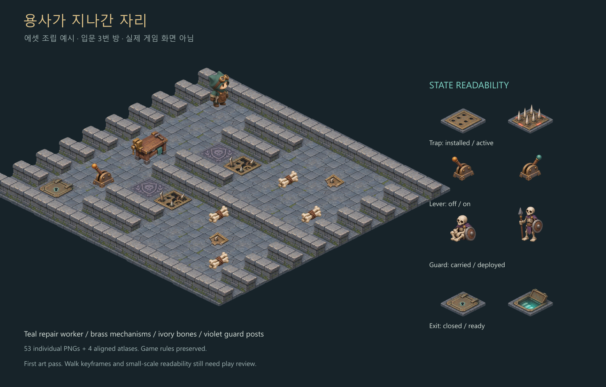
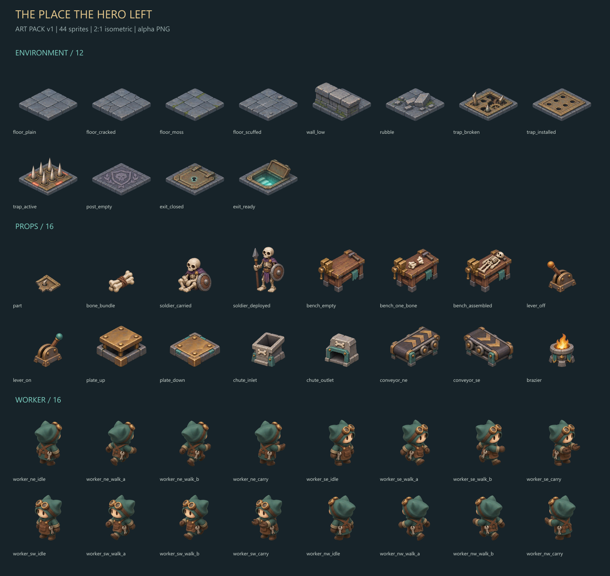

# 용사가 지나간 자리 — 시각 에셋 1차 팩

2026-11-08 최초 제작, 2026-11-09 낮은 벽 변형·방향·코너 추가. 기존 기획의 2.5D 던전 복구 퍼즐을 위한 **투명 PNG 53개와 정렬된 아틀라스 4장**이다. 청록색 수리공, 황동 장치, 회청색 석재, 상아색 뼈, 보라색 초소를 사용한다. 캐릭터와 화풍은 이번에 제안한 1차 디자인이다.



위 이미지는 실제 `data/stages.json`의 세 번째 방을 에셋으로 조립한 제작 단계의 검토용 이미지다. **현재 `main.py`에도 에셋을 적용했다.** `game/art.py`에서 아틀라스를 로드하고, `game/view.py`에서 게임 상태에 맞춰 표시한다. [실제 게임 화면](../../docs/screenshots/stage-03.png)과 [복구 완료 화면](../../docs/screenshots/stage-03-cleared.png)을 확인할 수 있다.

## 구성

| 폴더 | 수량 | 내용 |
| --- | ---: | --- |
| `tiles/` | 21 | 바닥 4종, 낮은 벽 10종, 잔해, 함정 파손·설치·가동, 빈 초소, 출구 닫힘·준비 |
| `objects/` | 16 | 부품, 뼈 묶음, 운반·배치 병사, 작업대 3상태, 레버 2상태, 발판 2상태, 투입구 입·출력, 벨트 2방향, 화로 |
| `characters/worker/` | 16 | NE·SE·SW·NW 각 방향의 대기·걷기 A·걷기 B·운반 자세 |
| `atlases/` | 4 | 256px 셀로 재정렬한 환경·물체·캐릭터·낮은 벽 아틀라스 |
| `sources/` | 13 PNG + JSON | 최초 아틀라스 3장, 교체용 부품 원본 1장, 낮은 벽 원본 9장과 전체 프롬프트. 원본 PNG는 보존한다. |
| `previews/` | 3 | 전체 목록, 입문 3번 방 조립 예시, 4×4 타일 연결 검토 |

개별 PNG는 모두 **256×256 RGBA8**이다. 환경 아틀라스는 **1024×768**, 물체·캐릭터 아틀라스는 **1024×1024**, 추가 낮은 벽 아틀라스는 **1024×768**이다. 자세한 파일·크기·기준점·SHA-256·프레임 좌표는 [manifest.json](manifest.json)에 기록한다.



### 2026-11-09 부품 교체

운반 부품을 함정에서 떨어져 나온 황동 철판 조각으로 교체했다. 기존 함정과 같은 테두리, 리벳, 가시 구멍과 부러진 가시를 사용한다. `objects/part.png`와 물체 아틀라스의 해당 셀에 적용하며, 폭 96px과 바닥 기준점 `(128, 220)`은 유지한다. 파손·설치·가동 함정 타일은 기존 그림을 사용한다.

내장 `image_gen`으로 제작했다. [생성 원본](sources/part-fragment.png)과 [제작·투명 배경 정리 프롬프트](sources/part-fragment-prompts.json)를 보존하며, `tools/art/build.mjs`의 교체 원본 설정으로 재빌드할 수 있다. [바닥 배치](../../docs/screenshots/stage-01-trap-fragment.png)와 [운반 화면](../../docs/screenshots/stage-01-trap-fragment-carried.png)을 실제 SDL 화면에서 확인했다.

### 2026-11-09 낮은 벽의 반복 완화

1번 방 통로 옆 낮은 석축에 깨진 덮개돌(`wall_low_chipped`), 크기가 다른 돌을 끼운 보수 벽(`wall_low_patched`), 녹슨 철띠 보강 벽(`wall_low_braced`)을 추가했다. 기존 `wall_low`와 동일한 표시 영역 224×147과 기준점 `(128, 160)`으로 정렬한다. 원래 벽 및 잔해와 섞어 사용하며, 외곽 높은 벽 앞의 석축에도 적용한다. 좌표에 따라 선택이 고정되므로 이동·재시작 때 무늬가 바뀌지 않는다. 다른 방과 충돌 판정은 그대로다.

내장 `image_gen`으로 제작한 [전체 프롬프트](sources/low-wall-prompts.json)와 원본 3장을 보존한다. `node tools/art/build.mjs`로 재빌드한다. [최초 적용 화면](../../docs/screenshots/stage-01-varied-low-walls.png)에서 벽 변형을 확인할 수 있다.

### 2026-11-09 낮은 벽의 방향·코너 확장

반대 축 직선 `wall_low_axis_y`, 네 방향 ㄴ자 `wall_low_corner_nw/ne/se/sw`, 끝마감 기둥 `wall_low_pier`를 추가했다. 방향 이름은 화면 방위가 아니라 지도 격자의 연결 방향이다. 예를 들어 `corner_ne`는 위 `(0,-1)`와 오른쪽 `(1,0)` 이웃으로 뻗는다. 기존 직선은 격자의 x축, `axis_y`는 y축 방향이다.

내장 `image_gen`으로 제작한 [프롬프트 6개](sources/low-wall-connections-prompts.json)와 생성 원본을 보존한다. 추가 낮은 벽 아틀라스는 4×3 셀 중 9개를 사용한다. 모든 새 타일은 바닥 기준점 `(128,160)`과 폭 224를 공유한다. 좌우로 열린 코너 `ne/sw`는 투영 깊이를 유지하도록 표시 높이 185, 나머지는 147로 정렬하며 바닥의 아래쪽 끝은 y=228에 맞춘다. [아틀라스](atlases/low_walls.png)에서 전체 구성을 볼 수 있다.

1번 방은 `connected_low_walls` 설정으로 주변 석축의 연결 방향을 검사한다. 통로·잔해·맵 바깥을 향한 면을 기준으로 직선, ㄴ자, 끝마감 기둥을 선택한다. 뒤쪽 높은 벽 앞의 석축은 잔해 패턴과 관계없이 이어지며, 넓은 벽 덩어리의 내부는 가장 가까운 통로 방향을 따른다. 다른 방은 기존 벽 선택을 유지한다. [실제 적용 화면](../../docs/screenshots/stage-01-connected-low-walls.png)에서 방향과 코너 연결을 확인할 수 있다.

## 좌표와 크기

PNG와 manifest의 기준점은 **좌상단 원점, 오른쪽 +x, 아래쪽 +y**다.

| 종류 | 기준점 | 의미 |
| --- | --- | --- |
| 환경 타일 | `(128, 160)` | 바닥 윗면의 중심 |
| 물체·수리공 | `(128, 220)` | 지면에 닿는 발밑 기준점 |

타일 한 칸의 윗면 기준 크기는 **224×112**다. 바닥 아래의 석재 두께는 별도다. 현재 8×8 방은 한 칸 폭 94px, `scale = 94 / 224`를 사용한다. 보드 이동 간격은 가로 47px, 세로 23.5px다. 렌더러는 이 2:1 비율을 유지한다.

타일과 물체는 같은 논리 칸의 바닥 중심에 기준점을 맞춰 그린다. PNG 사각형의 중심으로 그리면 물체가 떠 보인다. `pico2d`의 화면 y축은 위쪽이 양수이므로 아래와 같이 변환한다.

```python
import json
from pathlib import Path
import pico2d.pico2d as p

# 프로젝트 루트에 놓는 코드 기준. 다른 파일에서는 해당 위치에 맞게 ROOT를 지정한다.
ROOT = Path(__file__).resolve().parent
ART = ROOT / "assets" / "art_v1"
manifest = json.loads((ART / "manifest.json").read_text(encoding="utf-8"))

# open_canvas() 이후 한 번만 로드하고 재사용한다.
sprite_id = "worker_se_idle"
entry = manifest["sprites"][sprite_id]
image = p.load_image(str(ART / entry["file"]))

def draw_at_ground(image, entry, sx, sy, scale):
    """sx, sy: pico2d 화면에서 계산한 논리 칸 바닥 중심."""
    width, height = entry["width"], entry["height"]
    anchor = entry["anchor"]
    cx = sx + (width / 2 - anchor["x"]) * scale
    cy = sy + (anchor["y"] - height / 2) * scale
    image.draw(cx, cy, width * scale, height * scale)

draw_at_ground(image, entry, sx=445, sy=500, scale=94 / 224)
```

아틀라스를 사용할 때는 `entry["clip_rect_pico2d"]`를 그대로 `clip_draw()`에 전달한다. 이 값은 이미 **좌하단 원점**으로 변환돼 있다. 목적지 중심과 배율은 위 계산과 같다. 원본 `sources/` 아틀라스의 셀 크기나 해상도를 고정값으로 가정하지 않는다.

## 게임 상태 대응

| 현재 모델 상태 | 사용할 에셋 |
| --- | --- |
| 일반 바닥·벽 | `floor_plain` 등 / `wall_low` |
| `state.items[position] == "part"` | `part` |
| `state.items[position] == "bone"` | `bone_bundle` |
| 운반 중인 병사 | `soldier_carried` |
| `state.soldiers`에 있는 칸 | `post_empty` 위에 `soldier_deployed` |
| 아직 설치하지 않은 함정 | `trap_broken` |
| 설치했고 가동 전인 함정 | `trap_installed` |
| 가동한 함정 | `trap_active` |
| 가동 전·후 레버 | `lever_off` / `lever_on` |
| 작업대 납품 0·1개 | `bench_empty` / `bench_one_bone` |
| 출구 조건 미충족·충족 | `exit_closed` / `exit_ready` |

함정·초소·출구 타일은 바닥을 포함한다. 이 위에 일반 바닥을 다시 겹칠 필요가 없다. 레버·작업대·병사는 일반 바닥 또는 초소 위에 올리는 독립 물체다.

`bench_assembled`는 선택용 완성 연출이다. 현재 모델은 두 번째 뼈 납품 즉시 병사를 플레이어에게 주므로, 이 이미지를 지속 상태로 사용하는 로직은 없다. 출구 준비 여부는 기존 게임의 완료 조건을 재사용해야 한다.

캐릭터 `ne/se/sw/nw`는 **화면에서 보이는 방향**이다. W/위 = `ne`, D/오른쪽 = `se`, S/아래 = `sw`, A/왼쪽 = `nw`로 연결했다. 게임은 한 칸 이동을 0.18초 동안 표시하고, 전반·후반에 `walk_a`, `walk_b`를 사용한 뒤 대기로 돌아간다. 운반 중에는 `carry` 자세에 물건을 별도 합성한다. 논리 판정은 즉시 반영하고 표시 위치만 보간한다. 되돌리기·재시작·방 전환은 진행 중인 보간을 취소한다. manifest의 6fps는 제작 당시 제안값이며 현재 게임의 재생 간격과는 구분한다.

발판·뼈 투입구·운반 벨트는 **후속 기믹용 그림만 준비된 상태**다. 벨트는 `ne`, `se` 두 방향만 있다. UI 패널·버튼, 효과 애니메이션, 사운드, 최종 걷기 보정은 이번 팩에 포함하지 않는다.

## 재생성과 검사

게임을 실행할 때 Node.js나 sharp는 필요하지 않다. 에셋을 다시 자르고 정렬할 때만 제작 도구를 사용한다.

```powershell
npm ci --prefix tools/art
npm run build --prefix tools/art
.\.venv\Scripts\python.exe tools/art/check.py
.\.venv\Scripts\python.exe tools/art/check.py --window
```

- 빌드: 원본 알파, 원본 셀과 독립 원본의 가장자리 잘림, PNG 53개의 투명 여백과 출력 범위를 검사한다.
- 정적 검사: 모든 원본·개별 이미지·아틀라스의 PNG 헤더, 크기, RGBA8, SHA-256을 검사한다.
- 창 검사: 실제 pico2d/SDL에서 개별 PNG 53개와 아틀라스 4장을 로드한다. 개별 그리기 53개와 아틀라스 클립 그리기 53개의 화면 픽셀을 비교한다. 목록이 48개를 넘으면 검사 창의 열 수를 늘려 모든 스프라이트가 보이도록 한다.
- [validation.json](validation.json)은 빌드 검사, [runtime-validation.json](runtime-validation.json)은 SDL 검사 결과다. 런타임 결과는 manifest 해시를 포함한다. 재빌드 후 변경됐다면 창 검사를 다시 실행한다.

타일 연결, 조립 예시, 에셋을 적용한 실제 SDL 시작·완료 화면을 육안으로 확인했다. 기존 규칙 검사 10개와 SDL 키 이벤트를 사용하는 세 방 완료·운반·되돌리기·재시작 검사를 통과했다. 사람이 물리 키보드로 플레이하며 이동 중 가림, 운반물 위치, 걷기 연결감을 조정하는 작업은 남아 있다.

## 제작 출처와 보존

내장 `image_gen`으로 생성했다. 외부 게임이나 에셋 팩에서 가져온 이미지는 없다. 전체 생성 지시문은 [sources/prompts.json](sources/prompts.json)에 있다. 생성 요청 해상도와 실제 반환 해상도는 다를 수 있어 빌드에서 원본 크기를 읽고 분할한다.

`tools/art/build.mjs`에서 이미지 분할·크기 정렬·아틀라스 구성·미리보기를 처리한다. 알파 8/255 이하의 미세한 배경 노이즈만 내보내기에서 제거하며, 생성 원본은 수정하지 않는다. 타일은 2:1 보드 간격에 맞춰 세로 비율을 정규화했다.

후속 디자인 수정은 이 폴더와 원본을 보존하고 `art_v2` 같은 새 버전으로 제작한다.
