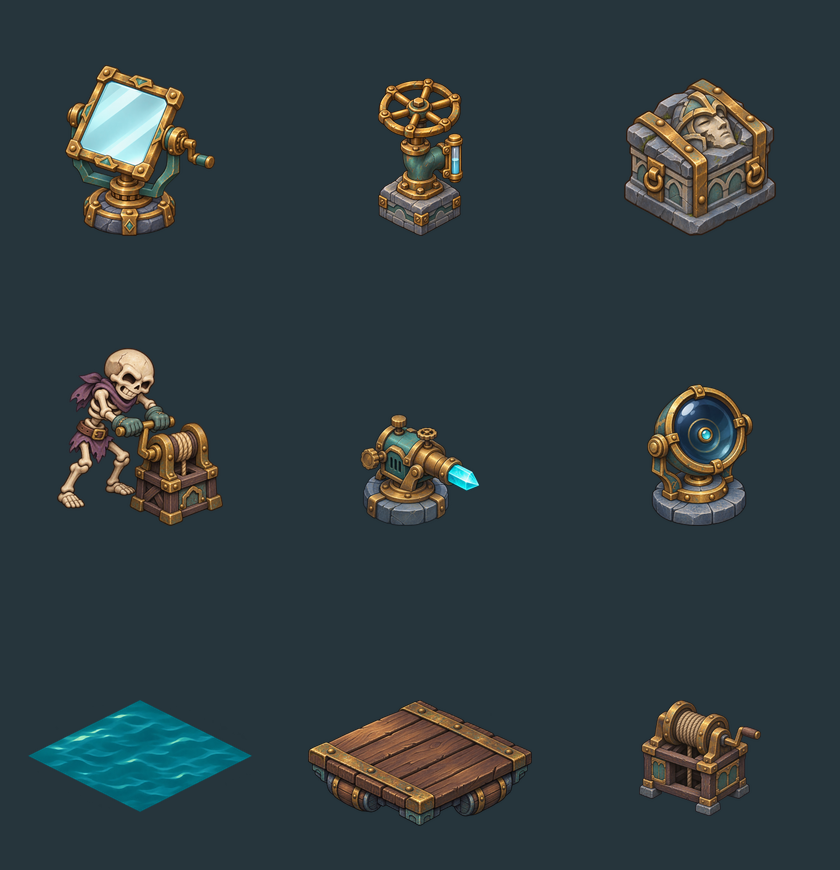

# 신규 기믹 에셋 1차

2026-11-13 내장 `image_gen`으로 제작했다. 기존 사선 화면의 황동·청록 장치, 회청색 석재, 보라색 해골을 따른다.

위에서부터 왼쪽 순서: 반사 거울, 수위 밸브, 밀 수 있는 잔해, 작업 중인 해골 인부, 마력 광원, 마력 수신기, 수면, 부교, 빈 윈치.

- `sources/`: 투명 배경 생성 원본 9장. 삭제하거나 덮어쓰지 않는다.
- `sprites/`: 256×256 RGBA 스프라이트 9장.
- `atlas.png`: 768×768 아틀라스.
- `manifest.json`: 기준점, 표시 영역, 아틀라스 좌표, SHA-256.
- `prompts.json`: 전체 프롬프트와 생성 도구·원본 경로.

`node tools/art/build-gimmicks.mjs`로 재빌드한다. 빌드는 알파 여백 정리, 크기 정렬, 포장만 수행한다. 광선·수신기 작동 표시와 거울 방향은 게임 상태에서 그린다. 해골 작업 자세는 정지 그림이며 별도 프레임 애니메이션은 포함하지 않는다.

검증: 원본 9장의 알파 배경, 유효 영역, 출력 크기, 아틀라스 좌표를 빌드에서 확인했고 목록 이미지를 육안 검토했다.

## 2026-11-13 잔해 접점 보정

게임 로딩 시 기존 에셋과 동일하게 `data/sprite_placement.json`의 지면 기준점을 적용한다. `push_rubble`의 기준점은 그림의 밑면 중심인 `(128,182)`다. 생성 팩의 기본 `(128,210)`을 그대로 사용하면 잔해가 지지면 뒤쪽으로 떠 보인다. 원본 그림과 크기는 유지하며, 렌더러는 발판을 먼저 그린 뒤 잔해를 얹고 발판의 눌림 높이를 함께 적용한다.

## 2026-11-13 수문 기믹 제거

밸브·물·부교는 현재 게임의 규칙·방 배치·도감에서 제거했다. 원본과 프롬프트는 제작 기록으로 보존하며, 런타임에서 이 세 스프라이트를 배치하지 않는다. 거울·광원·수신기·잔해·인부·윈치의 여섯 스프라이트를 사용한다.

## 2026-11-13 거울 표시 방향 보정

거울은 원본 전체의 좌우 반전 대신 `Art.draw_mirror`로 표시한다. 원본의 아래쪽 황동 받침대와 거울 면·옆날의 질감을 재사용하고, 거울판을 반사 판정과 같은 지도 축에서 투영한다. 방향에 따라 정면 또는 얇은 옆날이 보인다. 광선 접점·클릭 범위·도감도 이 표시를 사용한다. 생성 원본, PNG 스프라이트와 아틀라스 파일은 수정하지 않는다.

현재 거울은 네 방향을 사용한다. 정면의 유리, 반대편의 어두운 보강판, 양쪽 옆날을 구분하고 청록색 화살표로 앞면을 표시한다. 반사 판정과 표시가 같은 면의 축·법선을 사용하며, 화살표도 클릭할 수 있다. 뒷면의 색 변조는 공유 아틀라스에 남지 않도록 복원한다.
