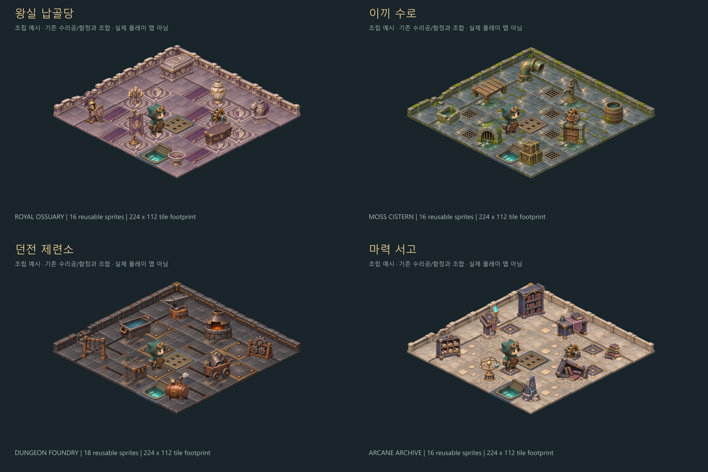

# 던전 맵 확장 에셋 — 4개 테마, 66종

2026-11-08 제작. 기존 `art_v1`의 수리공·퍼즐 장치와 조합하기 위한 맵 장식 팩이다. 테마마다 바닥 4종, 벽 4종, 독립 소품 8종을 제공한다. 프로토타입 0.7의 여섯 플레이 맵에 테마와 소품을 적용했다. [실제 게임 화면 비교](../../docs/screenshots/themes/overview.png)에서 확인할 수 있다.

2026-11-09 제련소에 긴 판석과 불규칙한 돌 바닥 2종을 추가했다. 제련소는 바닥 6종·벽 4종·소품 8종이며, 다른 테마 구성은 그대로다. 이후 사용자가 수정 대상을 낮은 벽으로 명확히 지정하여, 1번 방 바닥 배치와 선택 코드는 원래대로 복원했다. 추가 바닥 에셋과 [당시 검토 화면](../../docs/screenshots/stage-01-varied-corridor.png)은 보존한다. [현재 1번 방](../../docs/screenshots/stage-01-varied-low-walls.png)은 `art_v1`의 낮은 벽 변형 3종을 적용한 상태다.

추가 에셋은 내장 `image_gen`으로 제작했다. 원본 `forge/source/floor-slabs.png`, `forge/source/floor-patchwork.png`와 [전체 프롬프트](forge/source/floor-variation-prompts.json)를 보존한다. `source/spec.json`의 `extra_floors`를 읽어 기존 제작 명령으로 함께 빌드한다. 추가 바닥 2종은 현재 플레이 맵에서 사용하지 않는다.



위 그림은 실제 PNG를 조립한 검토용 예시이며 플레이 가능한 스테이지가 아니다. 기존 수리공, 부품, 설치한 함정, 출구는 크기와 화풍을 비교하려고 함께 배치했다.

## 테마와 활용

| 테마 | 색과 재질 | 구성 소품 | 배치 아이디어 |
| --- | --- | --- | --- |
| [왕실 납골당](crypt/previews/overview.png) | 보라색 석재·상아색 문양·오래된 금속 | 석관, 봉안 항아리, 부서진 석상, 촛대, 나무 관, 갑옷 받침대, 깃발, 봉헌 그릇 | 병사 복구 방. 문장 바닥과 깃발로 초소 주변을 강조하고, 파손 벽·석상으로 용사가 지나간 흔적을 표현한다. |
| [이끼 수로](sewer/previews/overview.png) | 젖은 회청색 돌·이끼·녹슨 구리 | 굽은 수도관, 수동 펌프, 물통, 짧은 나무다리, 수문, 갈대 수조, 배수구, 묶인 상자 | 운반 경로가 좁은 정비 구역. 배수 타일로 방향을 유도하고 외곽에 수도관·물통을 놓는다. |
| [던전 제련소](forge/previews/overview.png) | 검은 현무암·철·황동·주황빛 불씨 | 모루, 숯 화덕, 기어 진열대, 담금질 수조, 고철 수레, 공구대, 철제 상자, 보일러 | 함정 부품 복구 방. 철판 바닥과 공구대로 작업 구역을 묶고 파손 벽·고철을 작업 전후 연출에 사용한다. |
| [마력 서고](archive/previews/overview.png) | 밝은 석회암·청색 목재·보라색 천·작은 청록빛 | 책장, 필기 책상, 책 더미, 수정 독서대, 쓰러진 책장, 두루마리장, 천체 모형, 깨진 비석 | 순서 퍼즐 방. 바닥 문양과 독서대로 중요 지점을 구분하고 책 더미·파손 가구로 공간의 사연을 만든다. |

배치 아이디어는 아트 활용 제안이다. 펌프·수문·화덕·마법 문양 등에 작동 규칙을 추가하지 않았다.

## 파일 구성

각 테마 폴더의 구조는 같다.

```text
crypt/ 또는 sewer/, forge/, archive/
├── tiles/              # 바닥 4개(제련소 6개) + 벽 4개, 개별 PNG
├── props/              # 독립 소품 8개, 개별 PNG
├── atlas.png           # 4×4 아틀라스, 제련소는 4×5
├── manifest.json       # 파일, 기준점, clip_draw 좌표, 종류, SHA-256
├── validation.json     # 투명도·잘림·여백 검사
├── previews/
│   ├── overview.png    # 파일명이 있는 전체 목록
│   └── room.png        # 기존 에셋과 조합한 방 예시
└── source/
    ├── atlas.png       # 수정하지 않은 생성 원본
    └── spec.json       # 전체 프롬프트, 에셋 설명, 내보내기 설정
```

- 개별 PNG: **256×256 RGBA**, 투명 배경.
- 아틀라스: **1024×1024**, **256×256 셀 4×4**, 테마당 1장. 제련소는 바닥 추가로 **1024×1280**, **4×5**이며 마지막 두 셀은 비어 있다.
- 타일 윗면 기준 크기: **224×112**, 기존 `art_v1`과 동일한 2:1 간격.
- 바닥·벽 PNG 기준점: **(128, 160)**, 바닥 윗면 중심.
- 독립 소품 PNG 기준점: **(128, 220)**, 바닥 접점.
- PNG 기준점은 좌상단 원점이다. `clip_rect_pico2d`만 좌하단 원점으로 변환했다.

테마 이름을 파일 ID 앞에 붙였다. 예를 들어 `crypt_floor_plain`과 `sewer_floor_plain`을 동시에 사용해도 이름이 겹치지 않는다. 폴더별 manifest를 함께 읽으면 테마를 섞어 사용할 수 있다.

## 바닥과 벽 배치

`floor_plain`을 기본 바닥으로 넓게 깔고, 다른 바닥은 길·중요 지점·작업 구역에 제한적으로 사용하면 기능성 함정과 출구가 더 잘 보인다. 조립 예시는 모든 종류를 보여주려고 장식 바닥을 많이 사용했다.

벽 4종은 다음과 같다.

| 접미사 | 그림 방향 | 권장 용도 |
| --- | --- | --- |
| `wall_nw` | 타일의 뒤쪽 왼쪽 변, 왼쪽 꼭짓점에서 위 꼭짓점 | 방의 뒤쪽 왼쪽 외곽 |
| `wall_ne` | 타일의 뒤쪽 오른쪽 변, 위 꼭짓점에서 오른쪽 꼭짓점 | 방의 뒤쪽 오른쪽 외곽 |
| `wall_corner` | 두 뒤쪽 변이 만나는 L자 | 방 뒤 모서리 |
| `wall_broken` | 뒤쪽 왼쪽 벽의 파손형 | 용사가 파괴한 외곽, 복구 전 연출 |

벽 PNG에는 바닥이 포함된다. 빈 면이 보이는 **경계 장식용 벽**이므로, 기존 `#`처럼 칸 전체가 막힌 벽과 용도를 구분한다. 이 이미지가 충돌을 자동으로 만들지는 않는다. 중앙 통로를 막을 때는 기존 낮은 블록 벽을 유지하거나 별도 판정을 설계한다. 앞쪽 외곽에 높은 가구를 놓으면 캐릭터를 가릴 수 있으므로 책장·석관·수문은 뒤쪽 또는 옆쪽 배치가 적합하다.

`props/`에는 바닥 타일이 없다. 먼저 바닥을 그린 뒤 소품을 깊이순으로 그린다. 작은 방에서 소품을 전부 넣기보다 테마를 대표하는 큰 소품 1~2개와 작은 소품 몇 개를 골라 사용하는 편이 좋다.

## pico2d 사용 예

현재 `game/art.py`는 기본 `art_v1`을 읽고, `load_theme()`로 해당 방의 맵 팩을 한 번만 추가 로드한다. 테마별 아틀라스 경로는 클릭 판정용 알파 캐시에도 사용한다. `data/scenery.json`에 방별 테마·색·바닥 종류·장식 좌표를 기록하며, `game/themes.py`가 장식이 기존 벽칸에 있는지 확인한다. 소품 그림은 이동할 바닥의 마우스 클릭을 가로채지 않는다. 아래 코드는 같은 기준점 계산을 사용하는 독립 예시다.

```python
import json
from pathlib import Path
import pico2d.pico2d as p

# 프로젝트 루트 파일에 넣는 예시.
root = Path(__file__).resolve().parent / "assets" / "map_pack_v1" / "crypt"
manifest = json.loads((root / "manifest.json").read_text(encoding="utf-8"))
atlas = p.load_image(str(root / "atlas.png"))

def draw_map_asset(sprite_id, sx, sy, tile_width=94):
    entry = manifest["sprites"][sprite_id]
    scale = tile_width / 224
    ax, ay = entry["anchor"]["x"], entry["anchor"]["y"]
    atlas.clip_draw(
        *entry["clip_rect_pico2d"],
        sx + (128 - ax) * scale,
        sy + (ay - 128) * scale,
        256 * scale, 256 * scale,
    )

# sx, sy는 논리 칸의 바닥 중심. 바닥을 먼저 그린다.
draw_map_asset("crypt_floor_plain", 445, 500)
draw_map_asset("crypt_sarcophagus", 445, 500)
```

## 재생성·검사·제작 출처

내장 **image_gen**으로 테마별 원본 아틀라스를 생성했다. 외부 에셋 팩은 사용하지 않았다. 각 `source/spec.json`에 전체 생성 프롬프트를 보존한다. 기존 에셋은 별도 `art_v1`에 그대로 보존한다.

```powershell
npm ci --prefix tools/art
npm run build:maps --prefix tools/art -- crypt
# 전체 테마 다시 내보내기
npm run build:maps --prefix tools/art
```

빌드는 실제 원본 해상도를 읽어 분할한다. 알파 8/255 이하의 배경 노이즈를 내보내기에서 제거하고, 투명 PNG·기준점·아틀라스를 만든다. 바닥은 기존 타일 간격에 맞춰 세로 비율을 정규화한다. 원본 이미지 자체는 수정하지 않는다.

제작 단계에서 64개 셀의 투명 배경·셀 경계 잘림·출력 여백 검사를 통과했다. 게임 적용 후에는 실제 여섯 방의 시작 화면, 네 테마의 로딩·알파 선택, SDL 클릭 이동과 여섯 방 클리어·재시작·방 전환을 확인했다. 장식 32개는 기존 벽칸에만 배치했다. 모델과 스테이지 지도를 수정하지 않아 전체 규칙 단위 검사는 반복하지 않았다. 사람이 물리 마우스·키보드로 장시간 플레이하며 가림과 조작감을 확인하는 작업은 별도다.
