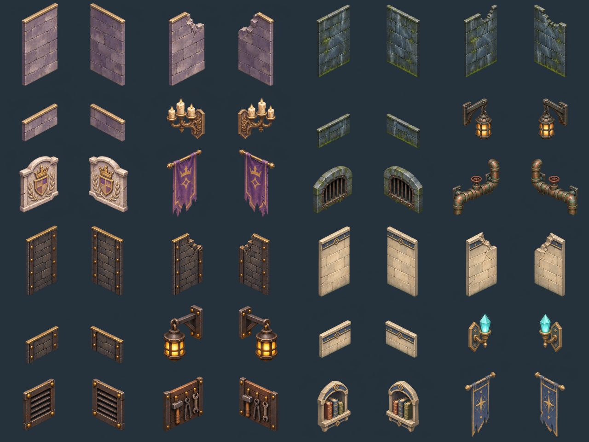

# 벽면 확장 에셋 — 4개 테마, 48종

2026-11-09 제작. `image_gen.imagegen`으로 기존 사선 시점과 손으로 그린 재질에 맞춰 생성했다. 각 테마는 높은 벽·파손 벽·낮은 벽 3종과 벽 장식 3종을 각각 NW/NE 방향으로 제공한다. **벽 PNG에 바닥은 포함되지 않는다.**



| 테마 | 벽 재질 | 벽에 붙이는 장식 | 개별 목록 |
| --- | --- | --- | --- |
| 왕실 납골당 | 보라빛 석재·금색 테두리 | 촛대·왕실 문장·깃발 | [12종](crypt/previews/overview.png) |
| 이끼 수로 | 젖은 돌·이끼·부식된 금속 | 철제 등불·배수구·구리 배관 | [12종](sewer/previews/overview.png) |
| 던전 제련소 | 현무암·철제 보강·황동 리벳 | 작업등·환기구·공구판 | [12종](forge/previews/overview.png) |
| 마력 서고 | 밝은 석회암·청색 띠 | 수정 조명·벽 책꽂이·별 문양 깃발 | [12종](archive/previews/overview.png) |

## 파일과 기준점

- `<테마>/walls/`: 벽면 6개, `<테마>/mounts/`: 장식 6개. 모두 **256×384 RGBA PNG**.
- `<테마>/atlas.png`: **1024×1152**, 4열×3행. 아틀라스 ID는 `walls_<테마>`.
- `manifest.json`: 파일, 방향, 실제 그림 범위, 기준점, pico2d 잘라 그리기 좌표, SHA-256.
- `source/atlas.png`: 수정하지 않은 1448×1086 생성 원본. `source/spec.json`: 테마별 전체 프롬프트와 생성 설정.
- `validation.json`: 12종의 투명도, 원본 잘림, 출력 여백 검사 결과.

PNG는 좌상단 원점이다. 벽 기준점 **(128,340)**을 논리 타일의 바닥 중심에 놓는다. 기존 224×112 마름모 바닥을 먼저 그린다. NW는 뒤쪽 왼쪽 변, NE는 뒤쪽 오른쪽 변이다. 모서리는 같은 타일에 두 방향을 겹쳐 조립한다. 높은 벽의 수직 높이는 약 232px다.

장식 기준점 **(128,192)**은 장식 중심이다. 벽면 중앙을 기준으로 NW는 바닥 중심에서 `(-56,+150)`, NE는 `(+56,+150)`만큼 이동해 그린다. 이 오프셋은 pico2d 화면 좌표 기준이며 벽과 같은 배율을 곱한다. 배수구는 높이를 낮춰 바닥 가까이 둘 수 있다. `clip_rect_pico2d`만 좌하단 원점이다.

앞쪽과 통로에는 낮은 벽을 사용하면 캐릭터와 퍼즐 장치를 가리지 않는다. 이미지 자체가 이동·충돌 판정을 만들지는 않는다. 기존 `map_pack_v1`의 바닥 포함 난간과 구분해 사용한다.

## 다시 내보내기

```powershell
cd tools/art
npm ci
npm run build:walls
# 일부 테마만: node build-walls.mjs crypt sewer
```

`build-walls.mjs`는 실제 알파 여백으로 원본의 행을 찾아 분리한다. 생성 원본의 행 높이가 서로 다르므로 균등한 3등분으로 잘라서는 안 된다. 원본과 프롬프트는 보존하고 파생 PNG·목록·검사 결과만 다시 만든다. Node/sharp는 에셋 제작 도구이며 게임 실행에는 필요 없다.
