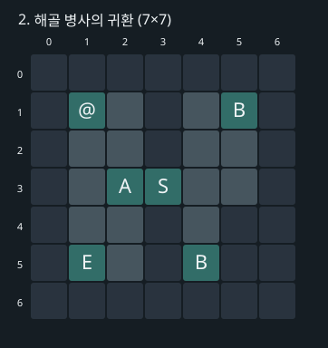
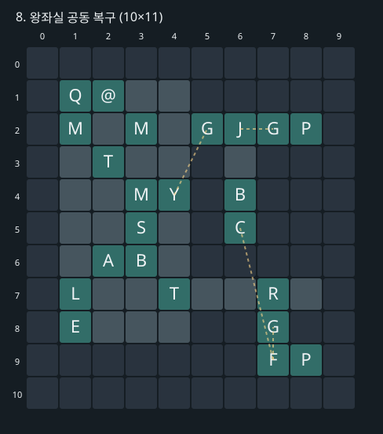

# 기믹에 맞춘 방 크기와 배치

2026-11-16. 외곽 벽을 포함한 크기다. 1번은 무제한이다. 2~8번의 행동 제한에는 최소 풀이보다 7~11회의 여유를 뒀다. 표와 좌표 배치도는 현재 게임 데이터 기준이다.

| 방 | 크기 | 바닥 칸 | 최소 행동 | 제한 | 여유 |
| --- | --- | ---: | ---: | ---: | ---: |
| 1 | 6×6 | 11 | 12 | 무제한 | — |
| 2 | 9×8 | 32 | 36 | 43 | 7 |
| 3 | 8×8 | 25 | 49 | 57 | 8 |
| 4 | 12×11 | 38 | 68 | 78 | 10 |
| 5 | 10×9 | 39 | 50 | 58 | 8 |
| 6 | 10×10 | 31 | 63 | 72 | 9 |
| 7 | 11×9 | 33 | 70 | 80 | 10 |
| 8 | 12×12 | 58 | 122 | 133 | 11 |

## 배치와 풀이

@ 출발 · E 출구 · P 부품 · B 뼈 · T 함정 · L 레버 · A 조립대 · S 초소 · F 발판 · G 문 · C 투입구 · O 배출구 · Q 광원 · M 거울 · Y 수신기 · R 잔해 · J 윈치

### 1번 — 무너진 정비실

위쪽 정비 작업장에서 부품을 챙겨 함정 시험로에 설치한다. 시험로를 건너 남쪽 시운전 구역에서 레버를 당기면, 작업장으로 되돌아가는 길이 닫힌다.


### 2번 — 왕실 납골당

동쪽에 북쪽 묘실과 남쪽 묘실을 따로 두고 서쪽에 조립 의식실을 뒀다. 묘실을 방문하는 순서는 자유다. 뼈를 둘 다 꺼낸 뒤 중앙 초소를 채워 묘실 입구를 봉쇄한다.



### 3번 — 봉인된 마력 서고

북쪽과 남쪽 서가의 재료는 입구가 아닌 서가 안쪽에 모아 뒀다. 북쪽 초소를 채우기 전에 북쪽 서가를 비우고, 가동 전에 두 서가의 작업을 끝낸다.


### 4번 — 지하 감옥

간수 통로의 잔해를 P1에 밀어 첫 감방을 연다. 그 안의 뼈를 P2에 놓아 두 번째 감방을 열고, 두 번째 뼈로 P3을 누른다. 안쪽 무기고에 가려면 P2와 P3을 함께 열어 둬야 한다. 부품을 꺼낸 뒤 발판 위의 뼈를 조립에 쓴다.


### 5번 — 이끼 배수로

서쪽 수문 제어실, 북동쪽 상류 수로, 남쪽 집수실을 벽과 통로로 분리했다. 상류의 뼈를 투입구로 보내 집수실을 개방한다. 집수실의 뼈를 빼낸 뒤 발판의 뼈를 회수한다.


### 6번 — 마력 중계실

중앙 조작 통로에서 북쪽과 남쪽 수신실로 빛을 돌려 각각의 재료를 꺼낸다. 두 구역을 처리하는 순서는 자유다. 초소에 병사를 세우면 남쪽 광선이 끊기므로 남쪽 부품은 그 전에 빼낸다.


### 7번 — 왕실 보물창고

북쪽과 동쪽에 금고를 두고 각각 떨어진 윈치로 연결했다. 금고 하나에 인부를 배치하고 부품을 꺼낸 뒤 같은 인부를 회수해 다른 금고로 보낸다. 두 부품을 확보한 뒤 남쪽 출구 통로를 지킨다.


### 8번 — 마왕의 왕좌실

중앙 왕좌홀, 동쪽 제어실, 남쪽 무기고를 나눴다. 왕좌홀의 거울 세 개로 제어실을 열어 뼈를 무기고 발판으로 보낸다. 남쪽에서 부품을 먼저 꺼낸 뒤 발판의 뼈를 인부 조립에 사용한다. 동쪽 금고까지 비운 뒤 남쪽 방어선을 가동하고 철수한다.



## 검증

- 실제 `Game.act`로 최단 풀이를 탐색했다. 유일한 수신 경로에서 맞춘 거울을 다시 틀어 문을 닫는 입력만 최단성 보존 조건에 따라 제외한다. 인부가 반드시 필요한 문 안의 부품은 인부 운반·배치·회수 비용도 하한에 반영한다. 작은 방의 전체 상태 그래프로 이 하한과 최단 결과를 독립 검사한다.
- 4번 잔해·발판, 5번 거울·투입구·발판, 6번 거울, 7번 인부, 8번 잔해·거울·인부·투입구·발판은 생략하면 행동 제한 안에 완료할 수 없다.
- 최소 행동과 1회 부족한 예산, 자원 보존, 전체 되돌리기, 작은 격자의 클릭 판정, 튜토리얼과 SDL 키보드 완주를 검사한다.
- 화면을 열지 않고 SDL의 탑다운 모드에서 키보드 입력으로 여덟 방을 재생했다. 사람의 초회 체감 난이도는 미측정이다.

```powershell
python tools/solve_levels.py --check --check-mechanics --output docs/balance-report.json
python -m unittest discover -q
python tools/render_room_plans.py
```

[탐색 결과와 입력 SHA-256](balance-report.json) · [퍼즐 배치 규칙](퍼즐배치규칙.md)
