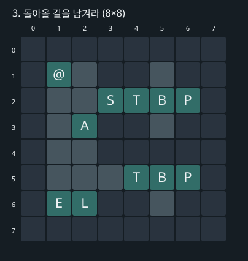
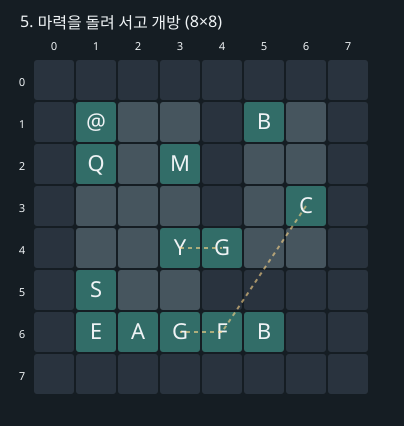

# 기믹에 맞춘 방 크기와 배치

2026-11-16. 외곽 벽을 포함한 크기다. 1번은 무제한이다. 2~8번의 행동 제한에는 최소 풀이보다 4~15회의 여유를 뒀다. 표와 좌표 배치도는 현재 게임 데이터 기준이다.

| 방 | 크기 | 바닥 칸 | 최소 행동 | 제한 | 여유 |
| --- | --- | ---: | ---: | ---: | ---: |
| 1 | 6×6 | 12 | 14 | 무제한 | — |
| 2 | 9×8 | 32 | 28 | 43 | 15 |
| 3 | 8×8 | 26 | 55 | 59 | 4 |
| 4 | 12×11 | 39 | 74 | 86 | 12 |
| 5 | 10×9 | 39 | 56 | 69 | 13 |
| 6 | 12×10 | 68 | 77 | 85 | 8 |
| 7 | 11×9 | 37 | 43 | 51 | 8 |
| 8 | 12×9 | 39 | 43 | 51 | 8 |

## 배치와 풀이

@ 출발 · E 출구 · P 부품 · B 뼈 · K 해골 · T 함정 · L 레버 · A 조립대 · S 초소 · F 발판 · G 문 · C 투입구 · O 배출구 · Q 광원 · M 거울 · N 이동 거울 · Y 수신기 · R 잔해 · J 기록석 · U 문양

### 1번 — 무너진 정비실

위쪽 작업장에서 함정을 고치고 시험로를 건넌다. 통로 끝 옆칸에 있는 시운전 레버를 당기면 작업장으로 돌아가는 길이 닫힌다. 출구는 아래 통로의 반대편에 있다.


### 2번 — 왕실 납골당

서쪽 납골 구역과 동쪽 묘실의 뼈를 작업대 한 곳에 모은다. 서쪽 작업대는 28회, 동쪽 작업대는 36회에 끝낼 수 있다. 중앙 초소에 병사를 세운 뒤 출구 방향으로 나간다.


### 3번 — 봉인된 마력 서고

북·남 서가의 재료를 꺼내고 두 입구의 함정을 고친다. 북쪽 안의 레버도 두 함정을 가동하지만, 그 자리에서 가동하면 돌아올 통로를 잃는다. 출구 근처 레버로 봉쇄할 길을 살펴야 한다.



### 4번 — 지하 감옥

간수 통로의 잔해를 P1에 밀어 첫 감방을 연다. 그 안의 뼈를 감방 입구 앞 P2에 놓고, 두 번째 뼈는 서쪽 벽 앞 P3에 둔다. 안쪽 무기고에 가려면 P2와 P3을 함께 열어 둬야 한다. 부품을 꺼낸 뒤 남쪽에서 병사를 조립해 동쪽 끝 초소를 채우고, 하단 복도에서 레버를 당긴 뒤 출구로 나간다.


### 5번 — 이끼 배수로

이동 거울을 방향키로 수신기 열에 맞추고 옆 칸에서 아래로 돌린다. 광로를 막는 잔해를 옆으로 밀어낸다. C1 투입구로 뼈를 보내 C1 배출구의 발판으로 남쪽 집수실을 개방한다. 집수실의 뼈를 빼낸 뒤 발판의 뼈를 회수한다.



### 6번 — 마력 중계실

서쪽과 동쪽에서 두 줄의 빛이 중앙 홀을 가로지른다. 중앙 레일에서 블록을 위로 밀면 아래쪽 광로가 열려 남동쪽 M1 보관실에 들어갈 수 있다. 뼈를 홀에 잠시 놓고 블록을 아래로 밀어 북동쪽 M2 작업실을 연다. 병사를 중계실 아래쪽 초소에 배치한 뒤 북서쪽 레버를 당기고 남서쪽 출구로 돌아간다.


### 7번 — 왕실 보물창고

기록석 `J1` 3걸음 · 한 번 기록 · `J2` 2걸음 · 한 번 기록

첫 기록석을 밟고 위, 아래, 위를 기록한다. 세 걸음을 마친 인부가 발판에 멈춰 첫 문을 유지한다. 안쪽 부품을 발판에 올려 해골을 회수한 뒤 초소와 함정을 복구한다. 두 번째 기록석에서는 위로 두 걸음을 기록하면 인부가 금고 쪽 발판에 멈춘다.


### 8번 — 마왕의 왕좌실

기록석 `J1/J2` 4걸음 · 한 번 기록

거울을 아래로 돌리고 차광 블록을 옆으로 밀어 동쪽 제어실을 연다. 부품으로 함정을 설치한 뒤 거울을 위로 돌려 M2를 연다. 기록석을 밟고 위, 위, 오른쪽, 오른쪽을 기록한다. 인부가 마지막 발판에 서면 두 문이 모두 열려 안쪽 레버까지 갈 수 있다.


## 검증

- 실제 `Game.act`로 최단 풀이를 탐색했다. 해골 인부의 현재 위치와 아직 수행할 방향을 탐색 상태에 포함한다. 작은 방의 전체 상태 그래프로 이동 하한과 최단 결과를 독립 검사한다.
- 4번 잔해·발판, 5번 잔해·거울 밀기와 회전·투입구·발판, 6번 차광 블록, 7번 인부·발판, 8번 차광 블록·거울·인부는 생략하면 행동 제한 안에 완료할 수 없다.
- 최소 행동과 1회 부족한 예산, 자원 보존, 전체 되돌리기, 작은 격자의 클릭 판정, 튜토리얼과 SDL 키보드 완주를 검사한다.
- 화면을 열지 않고 SDL의 탑다운 모드에서 키보드 입력으로 여덟 방을 재생했다. 사람의 초회 체감 난이도는 미측정이다.

```powershell
python tools/solve_levels.py --check --check-mechanics --output docs/balance-report.json
python -m unittest discover -q
python tools/render_room_plans.py
```

[탐색 결과와 입력 SHA-256](balance-report.json) · [퍼즐 배치 규칙](퍼즐배치규칙.md)
