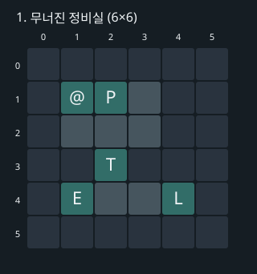
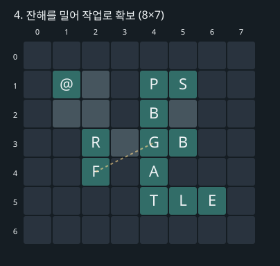

# 기믹에 맞춘 방 크기와 배치

2026-11-16. 외곽 벽을 포함한 크기다. 1번은 무제한이다. 2~8번의 행동 제한에는 최소 풀이보다 8~11회의 여유를 뒀다. 표와 좌표 배치도는 현재 게임 데이터 기준이다.

| 방 | 크기 | 바닥 칸 | 최소 행동 | 제한 | 여유 |
| --- | --- | ---: | ---: | ---: | ---: |
| 1 | 6×6 | 12 | 14 | 무제한 | — |
| 2 | 9×8 | 32 | 32 | 43 | 11 |
| 3 | 8×8 | 26 | 51 | 59 | 8 |
| 4 | 12×11 | 39 | 76 | 86 | 10 |
| 5 | 10×9 | 39 | 60 | 69 | 9 |
| 6 | 10×10 | 36 | 69 | 79 | 10 |
| 7 | 11×9 | 33 | 65 | 75 | 10 |
| 8 | 11×8 | 30 | 59 | 70 | 11 |

## 배치와 풀이

@ 출발 · E 출구 · P 부품 · B 뼈 · K 조립된 해골 · T 함정 · L 레버 · A 조립대 · S 초소 · F 발판 · G 문 · C 투입구 · O 배출구 · Q 광원 · M 거울 · Y 수신기 · R 잔해 · J 윈치

### 1번 — 무너진 정비실

위쪽 작업장에서 함정을 고치고 시험로를 건넌다. 통로 끝 옆칸에 있는 시운전 레버를 당기면 작업장으로 돌아가는 길이 닫힌다. 출구는 아래 통로의 반대편에 있다.



### 2번 — 왕실 납골당

서쪽 납골 구역과 동쪽 묘실의 뼈를 작업대 한 곳에 모은다. 서쪽 작업대는 32회, 동쪽 작업대는 40회에 끝낼 수 있다. 중앙 초소에 병사를 세운 뒤 출구 방향으로 나간다.


### 3번 — 봉인된 마력 서고

북·남 서가의 재료를 꺼내고 두 입구의 함정을 고친다. 북쪽 안의 레버도 두 함정을 가동하지만, 그 자리에서 가동하면 돌아올 통로를 잃는다. 출구 근처 레버로 봉쇄할 길을 살펴야 한다.


### 4번 — 지하 감옥

간수 통로의 잔해를 P1에 밀어 첫 감방을 연다. 그 안의 뼈를 감방 입구 앞 P2에 놓고, 두 번째 뼈는 서쪽 벽 앞 P3에 둔다. 안쪽 무기고에 가려면 P2와 P3을 함께 열어 둬야 한다. 부품을 꺼낸 뒤 남쪽에서 병사를 조립해 동쪽 끝 초소를 채우고, 하단 복도에서 레버를 당긴 뒤 출구로 나간다.



### 5번 — 이끼 배수로

수문 광선을 막는 잔해를 옆으로 밀어 반사 경로를 비운다. 광선 방향으로 밀기만 하면 계속 막힌다. 상류에서 뼈를 보내 남쪽 집수실을 개방한다. 집수실의 뼈를 빼낸 뒤 발판의 뼈를 회수한다.


### 6번 — 마력 중계실

남쪽 수신실에서 부품과 뼈를 빼낸다. 북쪽에만 작업대가 있어 남쪽 뼈는 두 전력 상태를 건너야 한다. 거울은 빈손으로 돌려야 하므로 뼈를 중앙 통로에 잠시 내려놓고 전환한다. 북쪽에 놓인 뼈와 합쳐 조립한 뒤 초소를 채운다.


### 7번 — 왕실 보물창고

준비된 인부로 북쪽 금고를 열고 첫 부품을 가져온다. 그 부품을 P1 발판에 올려 바깥 문을 유지하면서, 인부를 두 번째 윈치에 옮겨 안쪽 문을 연다. 두 번째 부품과 인부를 꺼내기 전에는 발판의 부품을 설치할 수 없다.


### 8번 — 마왕의 왕좌실

중앙 거울로 동쪽 M1 문을 열어 해골을 윈치에 배치한다. 인부를 남겨둔 채 거울을 돌리면 M1이 닫히고 북쪽 M2가 열리며, 금고의 J1은 열린 채로 남는다. 이때 부품을 꺼내 함정을 설치한다. M1을 다시 열어 인부를 회수하고 중앙 초소에 배치하면 M1 광선이 영구히 차단된다. 마지막으로 M2를 다시 열고 함정을 건넌 뒤 안쪽 레버를 가동해 빠져나간다.


## 검증

- 실제 `Game.act`로 최단 풀이를 탐색했다. 수신에 필요한 방향이 하나뿐인 거울은 그 방향에서 다시 돌려 문을 닫는 입력을 제외한다. 인부가 반드시 필요한 문 안의 부품은 인부 운반·배치·회수 비용도 하한에 반영한다. 작은 방의 전체 상태 그래프로 이 하한과 최단 결과를 독립 검사한다.
- 4번 잔해·발판, 5번 잔해·거울·투입구·발판, 6번 거울, 7번 인부·발판, 8번 거울·인부는 생략하면 행동 제한 안에 완료할 수 없다.
- 최소 행동과 1회 부족한 예산, 자원 보존, 전체 되돌리기, 작은 격자의 클릭 판정, 튜토리얼과 SDL 키보드 완주를 검사한다.
- 화면을 열지 않고 SDL의 탑다운 모드에서 키보드 입력으로 여덟 방을 재생했다. 사람의 초회 체감 난이도는 미측정이다.

```powershell
python tools/solve_levels.py --check --check-mechanics --output docs/balance-report.json
python -m unittest discover -q
python tools/render_room_plans.py
```

[탐색 결과와 입력 SHA-256](balance-report.json) · [퍼즐 배치 규칙](퍼즐배치규칙.md)
