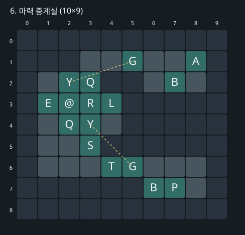
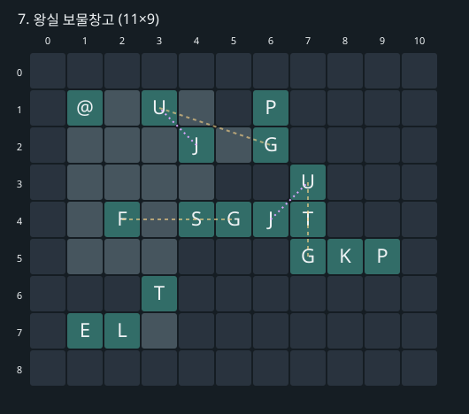

# 기믹에 맞춘 방 크기와 배치

2026-11-16. 외곽 벽을 포함한 크기다. 1번은 무제한이다. 2~8번의 행동 제한에는 최소 풀이보다 6~11회의 여유를 뒀다. 표와 좌표 배치도는 현재 게임 데이터 기준이다.

| 방 | 크기 | 바닥 칸 | 최소 행동 | 제한 | 여유 |
| --- | --- | ---: | ---: | ---: | ---: |
| 1 | 6×6 | 11 | 12 | 무제한 | — |
| 2 | 7×7 | 19 | 31 | 37 | 6 |
| 3 | 8×8 | 23 | 45 | 52 | 7 |
| 4 | 8×7 | 17 | 31 | 38 | 7 |
| 5 | 8×8 | 29 | 39 | 45 | 6 |
| 6 | 8×9 | 23 | 50 | 59 | 9 |
| 7 | 8×8 | 19 | 39 | 47 | 8 |
| 8 | 10×11 | 46 | 105 | 116 | 11 |

## 배치와 풀이

@ 출발 · E 출구 · P 부품 · B 뼈 · T 함정 · L 레버 · A 조립대 · S 초소 · F 발판 · G 문 · C 투입구 · O 배출구 · Q 광원 · M 거울 · Y 수신기 · R 잔해 · J 윈치

### 1번 — 첫 번째 복구

부품을 가져와 함정을 설치하고 건넌다. 남쪽 레버로 가동하면 시작 구역으로 돌아갈 수 없지만 서쪽 출구로 나갈 수 있다.


### 2번 — 해골 병사의 귀환

남쪽 뼈 보관실 입구를 가운데 쪽으로 옮겨 왕복을 줄였다. 두 뼈를 작업대에 납품한 뒤 초소에 병사를 배치하고 서쪽으로 나간다.


### 3번 — 돌아올 길을 남겨라

두 재료 구역에서 이동 목적이 없던 모서리 칸을 막았다. 위아래 함정 너머의 재료를 모두 회수한다. 초소를 배치하면 서쪽으로 나가고 마지막에 함정을 가동한다.


### 4번 — 잔해를 밀어 작업로 확보

잔해 바로 위에 서서 아래로 밀어 발판을 누른다. 열린 문 안에서 함정과 병사를 복구한다. 함정을 건넌 뒤 출구 옆 레버를 당긴다.


### 5번 — 마력을 돌려 서고 개방

거울을 돌려 첫 문을 열고, 안쪽 뼈를 투입구로 보내 두 번째 문 안의 발판을 누른다. 보관실의 뼈를 먼저 꺼낸 뒤 발판 위의 뼈를 회수한다.


### 6번 — 두 창고, 하나의 광원

첫 거울로 북쪽 뼈 창고와 남쪽 부품 창고 중 하나를 연다. 남쪽은 두 번째 거울에도 빛을 보내야 한다. 북쪽부터 회수해도 제한 안에 풀 수 있다. 남쪽 부품을 꺼내기 전에 병사를 초소에 세우면 병사가 광선을 막아 남쪽 문이 닫힌다.



### 7번 — 동료의 마지막 근무

윈치를 초소 바로 위로 옮기고 창고를 문 앞의 한 줄 통로로 줄였다. 인부를 배치해 부품을 꺼낸 뒤, 인부를 데려와 초소를 채운다. 함정을 건넌 뒤 레버를 가동한다.



### 8번 — 왕좌실 공동 복구

세 거울로 북동쪽 재료 구역을 열고 뼈를 투입구로 보낸다. 뼈가 남동쪽 창고 문을 연다. 잔해를 밀어 창고에 도착한 뒤 부품을 먼저 빼고 발판의 뼈를 회수한다. 작업대 옆 뼈와 함께 납품하고 인부로 북쪽 금고를 연다.


## 검증

- 실제 `Game.act`로 최단 풀이를 탐색했다. 유일한 수신 경로에서 맞춘 거울을 다시 틀어 문을 닫는 입력만 최단성 보존 조건에 따라 제외한다. 인부가 반드시 필요한 문 안의 부품은 인부 운반·배치·회수 비용도 하한에 반영한다. 작은 방의 전체 상태 그래프로 이 하한과 최단 결과를 독립 검사한다.
- 4번 잔해·발판, 5번 거울·투입구·발판, 6번 거울, 7번 인부, 8번 잔해·거울·인부·투입구·발판은 생략하면 필수 재료나 출구에 도달할 수 없다.
- 최소 행동과 1회 부족한 예산, 자원 보존, 전체 되돌리기, 작은 격자의 클릭 판정, 튜토리얼과 SDL 키보드 완주를 검사한다.
- 화면을 열지 않고 SDL의 탑다운 모드에서 키보드 입력으로 여덟 방을 재생했다. 사람의 초회 체감 난이도는 미측정이다.

```powershell
python tools/solve_levels.py --check --check-mechanics --output docs/balance-report.json
python -m unittest discover -q
python tools/render_room_plans.py
```

[탐색 결과와 입력 SHA-256](balance-report.json) · [퍼즐 배치 규칙](퍼즐배치규칙.md)
