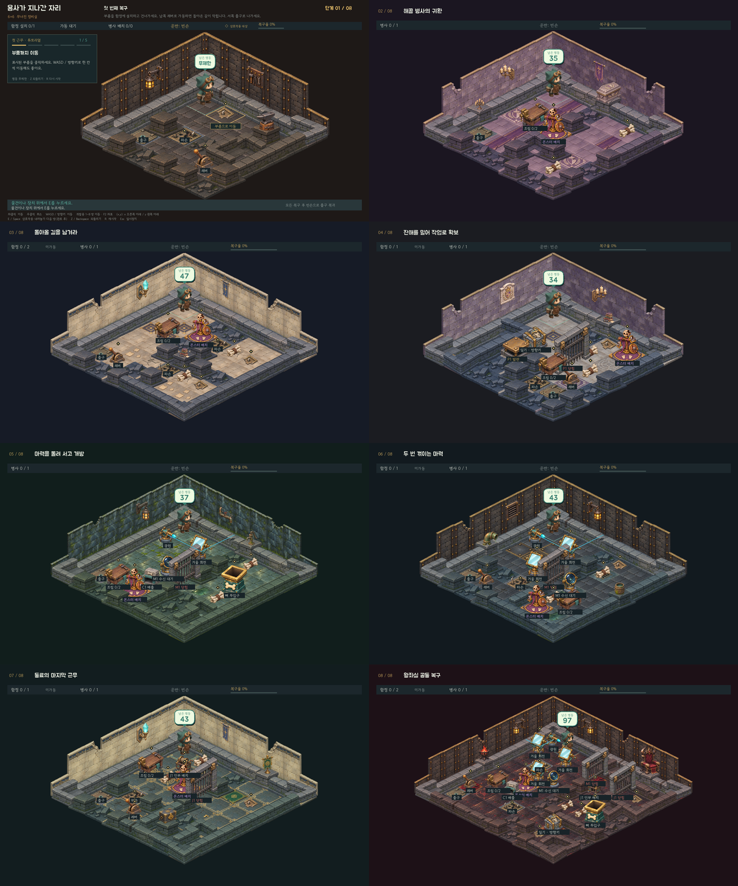
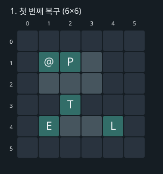
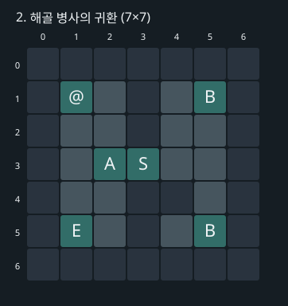
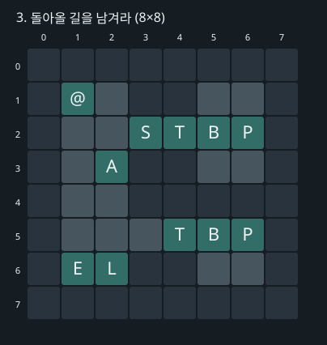
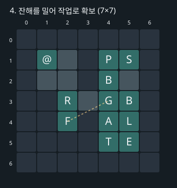
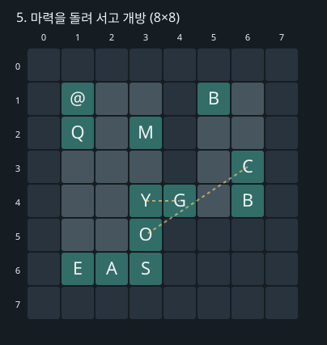
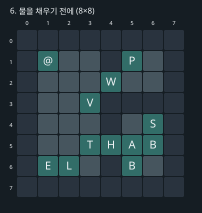
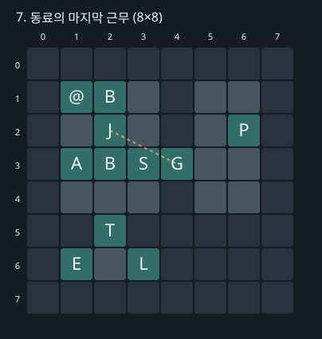
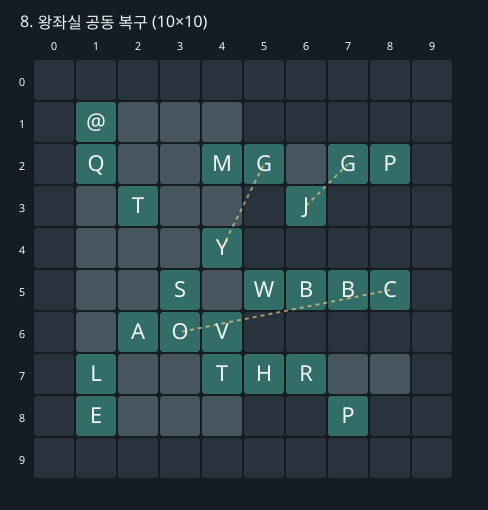

# 기믹에 맞춘 방 크기와 배치

2026-11-13. 외곽 벽을 포함한 크기다. 여덟 방과 복구 재료 수를 유지한다. 수문·수위는 제거했고, 5번 1회·6번 2회·8번 3회 반사로 거울을 확장했다. 1번은 무제한, 2~8번은 실제 게임 규칙으로 검증한 최소 행동 수+2회를 적용한다.

| 방 | 크기 | 바닥 칸 | 최소 행동 | 제한 |
| --- | --- | ---: | ---: | ---: |
| 1 | 6×6 | 11 | 12 | 무제한 |
| 2 | 7×7 | 20 | 33 | 35 |
| 3 | 8×8 | 26 | 45 | 47 |
| 4 | 7×7 | 17 | 32 | 34 |
| 5 | 8×8 | 27 | 35 | 37 |
| 6 | 8×8 | 29 | 41 | 43 |
| 7 | 8×8 | 25 | 41 | 43 |
| 8 | 10×10 | 46 | 95 | 97 |



## 배치와 풀이

@ 출발 · E 출구 · P 부품 · B 뼈 · T 함정 · L 레버 · A 조립대 · S 초소 · F 발판 · G 문 · C 투입구 · O 배출구 · Q 광원 · M 거울 · Y 수신기 · R 잔해 · J 윈치

### 1번 — 첫 번째 복구

부품을 가져와 함정을 설치하고 건넌다. 남쪽 레버로 가동하면 시작 구역으로 돌아갈 수 없지만 서쪽 출구로 나갈 수 있다.



[시작 화면](screenshots/compact-rooms/stage-01.png) · [완료 화면](screenshots/compact-rooms/stage-01-cleared.png)

### 2번 — 해골 병사의 귀환

동쪽 두 보관 구역의 뼈를 작업대로 가져온다. 조립한 병사를 가운데 초소에 배치하고 서쪽으로 이탈한다.



[시작 화면](screenshots/compact-rooms/stage-02.png) · [완료 화면](screenshots/compact-rooms/stage-02-cleared.png)

### 3번 — 돌아올 길을 남겨라

위쪽 함정 너머 부품과 뼈, 아래쪽 함정 너머 부품과 뼈를 모두 회수한다. 초소를 배치할 때 서쪽으로 나가고 마지막에 함정을 가동한다.



[시작 화면](screenshots/compact-rooms/stage-03.png) · [완료 화면](screenshots/compact-rooms/stage-03-cleared.png)

### 4번 — 잔해를 밀어 작업로 확보

잔해 바로 위에서 아래 방향키를 눌러 발판에 민다. 문으로 들어가 함정과 병사를 복구한다. 발판과 문 사이에 통로 한 칸을 두어 잔해가 보이게 했다.



[시작 화면](screenshots/compact-rooms/stage-04.png) · [완료 화면](screenshots/compact-rooms/stage-04-cleared.png)

### 5번 — 마력을 돌려 서고 개방

거울을 돌려 수신기에 빛을 보낸다. 안쪽 뼈 하나를 투입구로 보내고 다른 뼈를 들고 돌아와 조립한다. 두 뼈를 직접 왕복 운반하는 풀이는 행동 제한을 넘는다.



[시작 화면](screenshots/compact-rooms/stage-05.png) · [완료 화면](screenshots/compact-rooms/stage-05-cleared.png)

### 6번 — 두 번 꺾이는 마력

광원 (1,2)의 빛을 거울 (3,2), (3,4)에서 두 번 반사해 수신기 (5,4)에 보낸다. 두 거울 모두 돌려야 문이 열린다. 문 안의 부품을 가져와 함정을 설치하고 병사를 복구한 뒤 돌아온다.



[시작 화면](screenshots/compact-rooms/stage-06.png) · [완료 화면](screenshots/compact-rooms/stage-06-cleared.png)

### 7번 — 동료의 마지막 근무

병사를 조립해 윈치에 배치한다. 열린 창고의 부품으로 함정을 설치하고 인부를 회수해 초소에 배치한다. 함정을 건넌 뒤 레버를 가동해 출구로 나간다.



[시작 화면](screenshots/compact-rooms/stage-07.png) · [완료 화면](screenshots/compact-rooms/stage-07-cleared.png)

### 8번 — 왕좌실 공동 복구

광원 (1,1)에서 거울 (1,2), (3,2), (3,4)를 거쳐 수신기 (4,4)로 빛을 보낸다. 세 거울을 모두 맞춰야 재료 구역 입구가 열린다. 투입구로 뼈를 회수하고 인부로 금고를 연다. 잔해 너머 두 번째 부품을 회수한 뒤 인부를 초소에 배치하고 복구를 마친다.



[시작 화면](screenshots/compact-rooms/stage-08.png) · [완료 화면](screenshots/compact-rooms/stage-08-cleared.png)

## 검증

- 실제 `Game.act`로 최단 풀이를 탐색했다. 유일한 수신 경로에서 맞춘 거울을 다시 틀어 문을 닫는 입력만 최단성 보존 조건에 따라 제외한다. 인부가 반드시 필요한 문 안의 부품은 인부 운반·배치·회수 비용도 하한에 반영한다. 작은 방의 전체 상태 그래프로 이 하한과 최단 결과를 독립 검사한다.
- 4번 잔해·발판, 5번 거울·투입구, 6번 거울, 7번 인부, 8번 잔해·거울·인부·투입구를 각각 생략하면 행동 제한 안에 완료할 수 없다.
- 최소 행동과 1회 부족한 예산, 자원 보존, 전체 되돌리기, 작은 격자의 클릭 판정, 튜토리얼과 SDL 키보드 완주를 검사한다.
- 모니터에 창을 띄우지 않고 SDL dummy/software로 시작·작동·완료 화면을 확인했다. 물리 입력과 사람의 초회 플레이 난이도는 미측정이다.

```powershell
python tools/solve_levels.py --check --check-mechanics --output docs/balance-report.json
python -m unittest discover -q
python tools/render_room_plans.py
```

[탐색 결과와 입력 SHA-256](balance-report.json) · [퍼즐 배치 규칙](퍼즐배치규칙.md)
