# 새 기믹과 8개 방 배치 초안

2026-11-13. 벨트를 게임 규칙·지도·안내·도감에서 제거하고 네 가지 기믹을 추가했다. 이 문서의 지도는 실제 실행 데이터에서 생성한다. 1~3번 방은 유지하고 4~7번에서 새 기믹을 하나씩 소개한 뒤 8번에서 결합한다.

**상태: 직접 조작 가능한 배치 초안.** 4~8번의 완주와 되돌리기는 검증했지만 최단성·사람의 초회 플레이 난이도는 검증하지 않았다. 4~8번 행동 제한은 현재 무제한이다. 2번 52회·3번 69회는 유지한다. 초안 평가 후 최단 탐색과 행동 제한을 다시 정한다.

## 조작과 공통 규칙

- 거울: 거울 칸에서 빈손으로 E / Space. `/`와 `\` 방향을 번갈아 선택한다. 광선이 수신기에 닿는 동안 연결문을 연다. 벽·잔해·최종 초소 병사는 빛을 막고, 플레이어·운반물·문은 막지 않는다. 광선 자체는 피해를 주지 않는다.
- 수문과 수위: 밸브 칸에서 빈손으로 E / Space. 방 전체 수위는 낮음·높음 두 단계다. 낮으면 수로만, 높으면 부교만 통행할 수 있다. 잠길 수로나 내려갈 부교에 물건이 있으면 전환을 거부한다.
- 잔해: 빈손으로 인접한 잔해 쪽 방향키/WASD를 누르면 한 칸 밀며 이동한다. 빈 바닥·발판으로만 밀 수 있다. 당기거나 연속된 잔해를 동시에 밀 수 없다. 클릭 경로는 잔해를 자동으로 밀지 않는다.
- 해골 인부: 조립한 병사를 윈치 칸에서 E / Space로 작업 배치한다. 작업하는 동안 연결문이 열린다. 빈손으로 같은 자리에서 E / Space를 누르면 회수한다. 최종 초소 배치는 기존 규칙대로 고정된다.
- 성공한 회전·수위 전환·밀기·배치·회수는 각각 한 행동이다. 문과 광선 결과까지 Z / Backspace로 함께 되돌린다. 실패 입력은 행동을 소모하지 않는다.

## 전체 구성

| 방 | 역할 | 검증한 완주 행동 |
| --- | --- | ---: |
| 1~3 | 기존 함정·병사·복구 순서 | 기존 유지 |
| 4 | 잔해를 밀어 작업로 확보 | 42 |
| 5 | 마력을 돌려 서고 개방 | 39 |
| 6 | 물을 채우기 전에 | 52 |
| 7 | 동료의 마지막 근무 | 48 |
| 8 | 왕좌실 공동 복구 | 111 |

위 숫자는 기록한 완주 경로의 길이이며 최소 행동 수가 아니다.

## 지도 기호

| 기호 | 의미 |
| --- | --- |
| `@` | 출발 |
| `E` | 출구 |
| `P` | 부품 |
| `B` | 뼈 |
| `T` | 함정 |
| `L` | 레버 |
| `A` | 조립대 |
| `S` | 최종 초소 |
| `F` | 발판 |
| `G` | 연결문 |
| `C` | 투입구 |
| `O` | 배출구 |
| `M` | 거울 |
| `Q` | 마력 광원 |
| `Y` | 마력 수신기 |
| `V` | 수위 밸브 |
| `W` | 낮은 수로 |
| `H` | 부교 |
| `R` | 밀 수 있는 잔해 |
| `J` | 인부 윈치 |

`#`는 벽, `.`은 일반 바닥이다. 좌표는 왼쪽 위 `(0,0)` 기준 `(x,y)`다. 게임의 F2로 같은 좌표를 볼 수 있다. 배치도 점선은 장치와 연결문의 관계이며 이동 경로가 아니다.

## 4번 — 잔해를 밀어 작업로 확보

잔해가 막고 있는 작업로를 열면서 발판의 추로 재사용한다.

시작 구역에서 (3,3)까지 이동한 뒤 아래로 밀어 잔해를 (3,5) 발판에 놓는다. 열린 문으로 들어가 부품과 뼈를 회수하고 함정·초소를 복구한다.

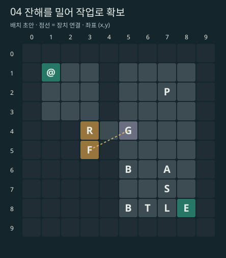

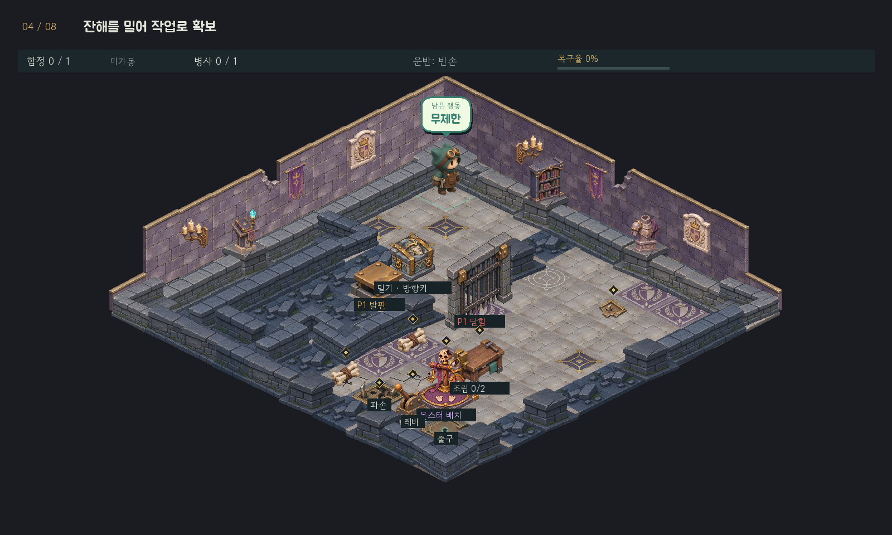

| 새 장치 | 좌표 |
| --- | --- |
| 밀 수 있는 잔해 | (3,4) |

## 5번 — 마력을 돌려 서고 개방

광선의 방향을 바꿔 닫힌 서고를 열고 기존 투입구를 다시 활용한다.

(3,2) 거울을 한 번 회전하면 (3,4) 수신기에 빛이 닿아 (5,5) 문이 열린다. 안쪽 뼈를 (7,4) 투입구로 보내고, (4,6) 배출구에서 회수해 병사를 조립한다.

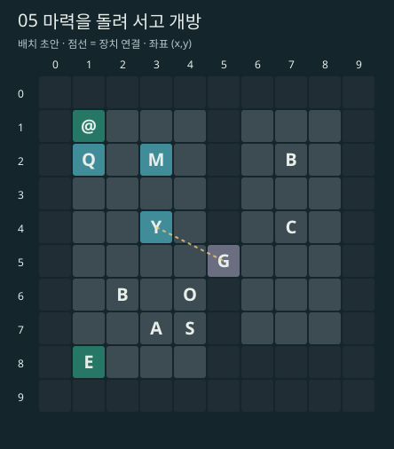

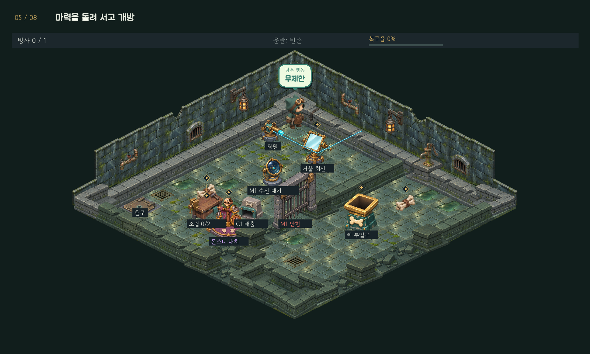

| 새 장치 | 좌표 |
| --- | --- |
| 거울 | (3,2) |
| 마력 광원 | (1,2) |
| 마력 수신기 | (3,4) |

## 6번 — 물을 채우기 전에

낮은 수로에서 할 일을 마친 뒤 높은 부교를 연결하는 순서를 배운다.

초기에는 (5,3) 낮은 수로를 건널 수 있다. (7,2) 부품을 회수해 함정을 설치하고 (3,4) 밸브를 조작한다. (5,6) 부교로 건너가 뼈를 모으고 병사를 복구한 뒤 돌아온다.

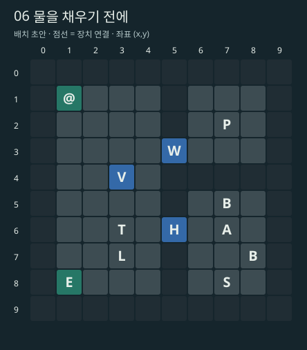

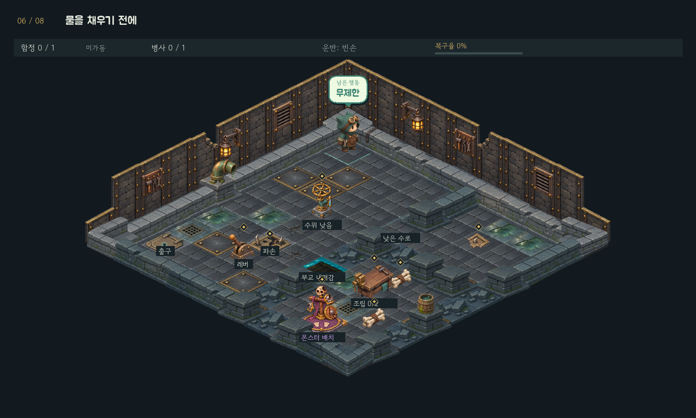

| 새 장치 | 좌표 |
| --- | --- |
| 수위 밸브 | (3,4) |
| 낮은 수로 | (5,3) |
| 부교 | (5,6) |

## 7번 — 동료의 마지막 근무

같은 해골을 작업 인부로 먼저 쓰고 마지막에 방어 병사로 배치한다.

뼈 두 묶음으로 병사를 조립해 (3,5) 윈치에 배치한다. (6,4) 문 너머 부품을 회수하고 함정을 설치한다. 윈치에서 인부를 회수해 최종 초소에 배치한 뒤 레버를 가동한다.

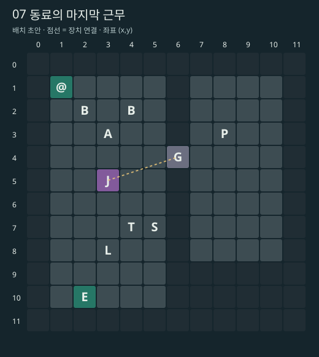

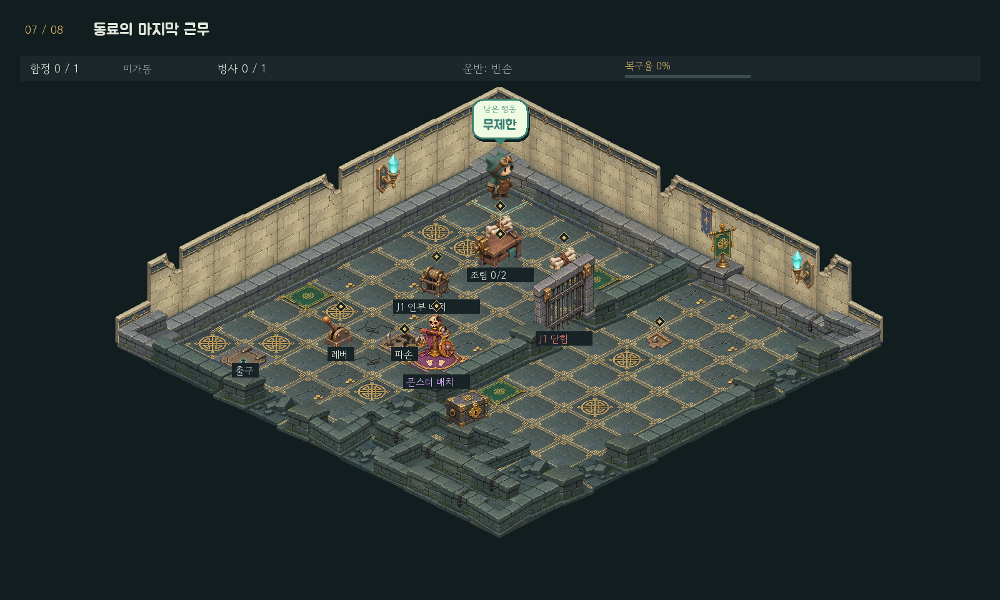

| 새 장치 | 좌표 |
| --- | --- |
| 인부 윈치 | (3,5) |

## 8번 — 왕좌실 공동 복구

거울·인부·수위·잔해를 순차적으로 결합한다. 각 장치는 별도 구역에 둔다.

거울로 M1 문을 열고 낮은 수로의 뼈를 회수한다. 병사를 J1 윈치에 배치해 금고 부품을 가져온다. 첫 함정을 설치한 뒤 급수하고, 부교를 건너 잔해를 오른쪽으로 두 번 밀어 두 번째 부품을 회수한다. 남은 함정을 설치하고 인부를 회수해 초소·레버·출구를 마무리한다.

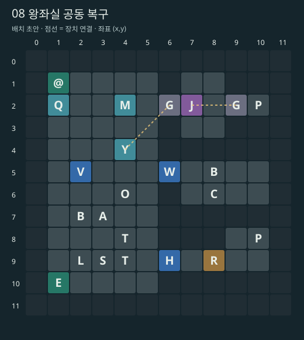

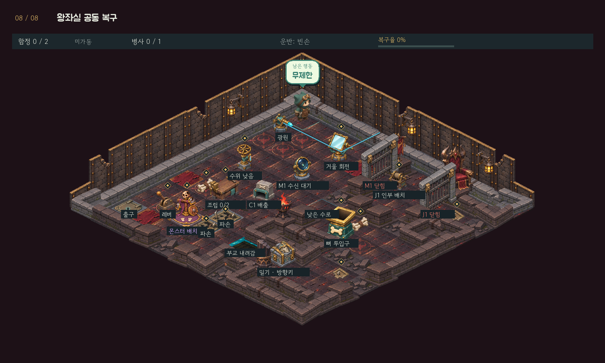

| 새 장치 | 좌표 |
| --- | --- |
| 거울 | (4,2) |
| 마력 광원 | (1,2) |
| 마력 수신기 | (4,4) |
| 수위 밸브 | (2,5) |
| 낮은 수로 | (6,5) |
| 부교 | (6,9) |
| 밀 수 있는 잔해 | (8,9) |
| 인부 윈치 | (7,2) |

## 에셋과 작동 화면

내장 `image_gen`으로 투명 에셋 9종을 제작했다. 원본·프롬프트·256px 스프라이트·아틀라스를 프로젝트 안에 보존한다. 기존 황동·청록 장치와 보라색 해골 계열을 따른다.

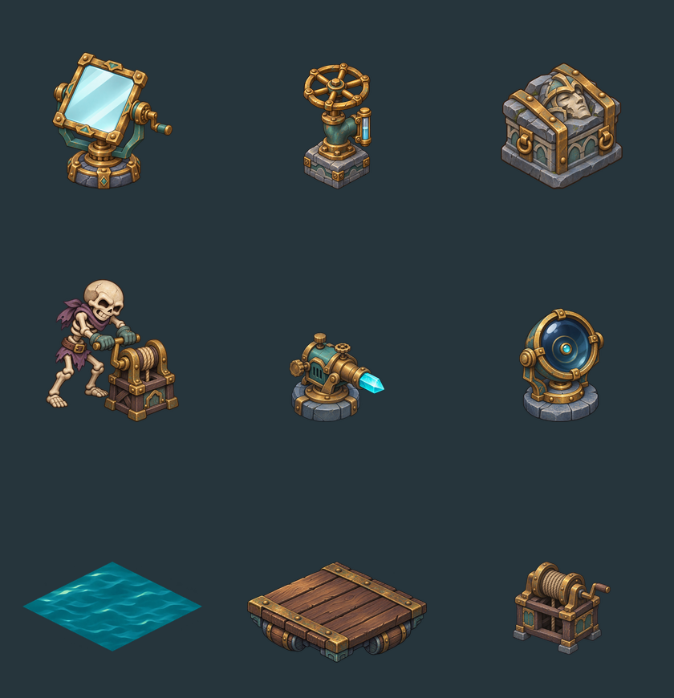

[에셋 명세와 프롬프트](../assets/gimmicks_v1/README.md) · [급수 상태](screenshots/gimmicks-v1/stage-06-water.png) · [인부 작업 상태](screenshots/gimmicks-v1/stage-07-helper.png) · [종합방 작동 상태](screenshots/gimmicks-v1/stage-08-water.png)

현재 인부 작업은 정지 자세이며, 거울·수위·잔해의 전환은 즉시 반영한다. 새 기믹 전용 프레임 애니메이션과 효과음은 이번 초안에 포함하지 않는다.

## 검증과 다음 평가

- 단위 검사 96개 통과. 광선 반사·순환 종료, 수위 점유 보호, 밀기 금지 조건, 인부 회수, 자원 보존, 전체 되돌리기를 포함한다.
- 실제 SDL software/dummy 환경에서 8개 방 키보드 완주, 새 장치 클릭, 장치 안내·도감, 문·발판 애니메이션과 일시정지 검사 통과. 모니터에 게임 창을 띄우지 않았다.
- `python tools/draft_routes.py`: 새 5개 방의 완주 및 전체 되돌리기. `data/gimmick_draft_routes.json`에 행동열을 보존한다.
- `python -m tests.smoke_gimmicks`: 초기 화면과 작동 상태 13장 재생성. `python tools/render_gimmick_plans.py`: 이 문서와 좌표 배치도 재생성.
- 후속 평가: 거울 방향의 직관성, 수위별 통로 구별, 인부 회수 시점, 종합방 왕복 길이를 직접 플레이로 확인한다. 8번의 111행동 참고 경로는 축약 여지가 있다. 최단 경로와 행동 제한은 아직 확정하지 않는다.
